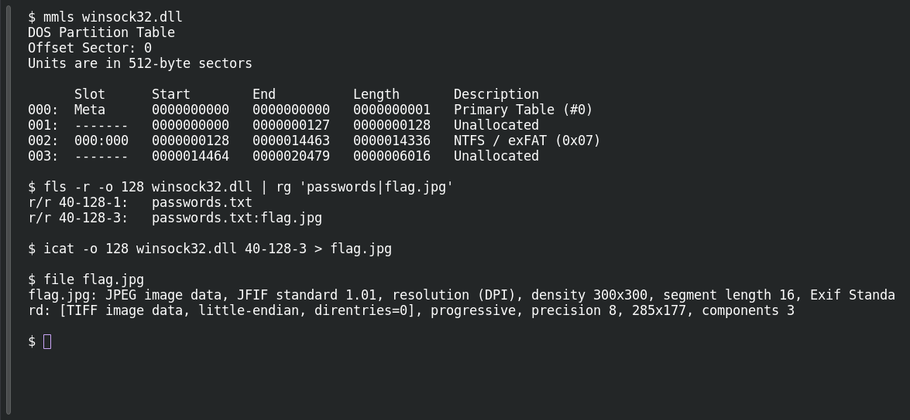

# Hidden

**Platform:** PCGCTF · **Challenge ID:** 75 · **Category:** Forensics · **Points:** 100

**Status:** Answer backed by the extracted stream. Exact PCGCTF submission not re-confirmed.

## The challenge

Recover the hidden message from a misleading DLL artifact.

## Solving it

Despite its `.dll` extension, `winsock32.dll` is a disk image. Its NTFS partition begins at sector 128. Use Sleuth Kit to identify the partition and list its files:

```sh
mmls winsock32.dll
fls -r -o 128 winsock32.dll
```

The listing contains the named stream `passwords.txt:flag.jpg`, with identifier `40-128-3`. Export it as a JPEG:

```sh
icat -o 128 winsock32.dll 40-128-3 > flag.jpg
```

Opening that JPEG reveals `flag{me0w_hia!}`. The challenge asks for the `pcgCTF` wrapper.

## Screenshots

Fresh local reproduction using the commands described above.



Extracted JPEG:


## Flag

```text
pcgCTF{me0w_hia!}
```

## Takeaway

NTFS Alternate Data Streams hide content beside a file without changing its visible size — check for them when an artifact seems too innocent.

## Reference

- [Original challenge description](../../unsolved/forensics/075-hidden/README.md)
