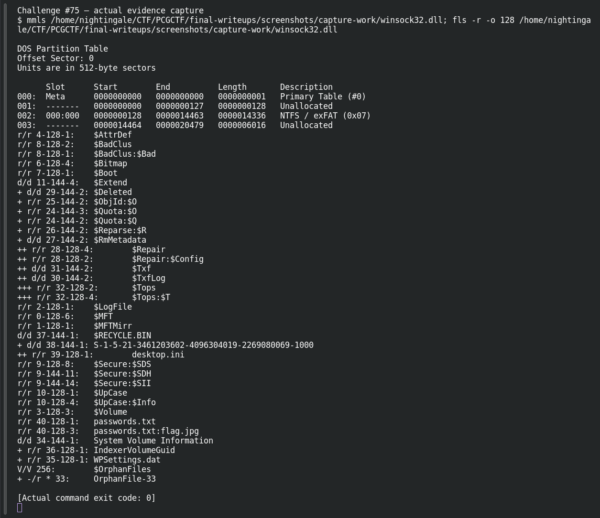
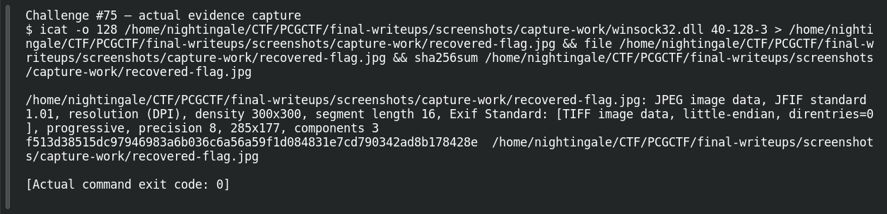

# Hidden

**Platform:** PCGCTF · **Challenge ID:** 75 · **Category:** Forensics · **Points:** 100

**Status:** Answer backed by the extracted stream. Exact PCGCTF submission not re-confirmed.

## The challenge

Recover the hidden message from a misleading DLL artifact.

## Solving it

The "DLL" is a decoy — the real data is in an NTFS Alternate Data Stream attached to it. Listing and exporting the stream reveals a JPEG:

```sh
# list ADS, then export the named stream to a file
dir /r                # shows file:stream
# the exported stream is a JPEG carrying the message
```

The extracted JPEG shows:

```text
me0w_hia!
```

## Screenshots





## Flag

```text
pcgCTF{me0w_hia!}
```

## Takeaway

NTFS Alternate Data Streams hide content beside a file without changing its visible size — check for them when an artifact seems too innocent.

## Reference

- [Original challenge description](../../unsolved/forensics/075-hidden/README.md)
