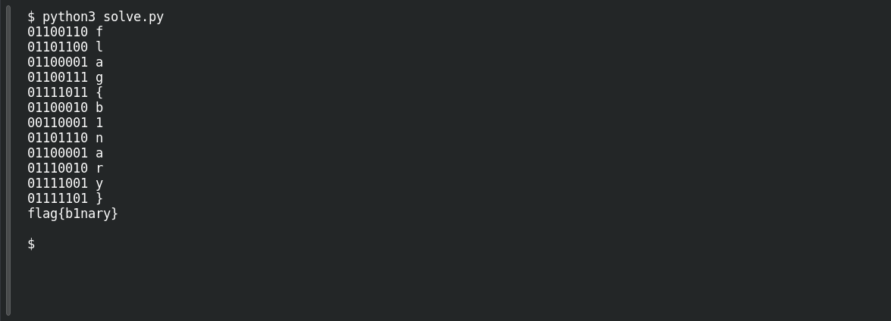

# Hit a Brick Wall

**Platform:** PCGCTF · **Challenge ID:** 77 · **Category:** Forensics · **Points:** 100

**Status:** Independently decoded during this review. Exact PCGCTF submission not re-confirmed.

## The challenge

Recover the message hidden in a wall of bricks.

## Solving it

The wall uses two brick colors. Treat the lighter color as `0` and the darker color as `1`. Each row contains eight bits; reading the rows from top to bottom produces twelve ASCII characters, including the flag wrapper.

The rows are staggered, so the sampling position alternates between rows. The script below samples the brick centers in the supplied image, prints each byte, and decodes it. Save it as `solve.py` beside `bricks.png`, then run `python3 solve.py`. [Download the script](../scripts/077-solve.py).

```python
from PIL import Image

image = Image.open("bricks.png").convert("RGB")
colors = {(240, 227, 213): "0", (224, 212, 199): "1"}
message = []
for row in range(12):
    y = 38 + 56 * row
    first_x = 115 if row % 2 == 0 else 62
    bits = "".join(colors[image.getpixel((round(first_x + 108.5 * col), y))]
                   for col in range(8))
    message.append(chr(int(bits, 2)))
    print(bits, message[-1])
print("".join(message))
```

The decoded message is `flag{b1nary}`. The requested submission uses `pcgCTF{b1nary}`.

## Screenshots

Fresh local reproduction using the command described above.



[Original brick-wall image](../../unsolved/forensics-steganography/077-hit-a-brick-wall/files/bricks.png).

## Flag

```text
pcgCTF{b1nary}
```

## Takeaway

A two-state visual pattern (brick colours, lights, tiles) is usually binary — map the two states to 0/1, read in order, and decode as ASCII.

## Reference

- [Original challenge description](../../unsolved/forensics-steganography/077-hit-a-brick-wall/README.md)
