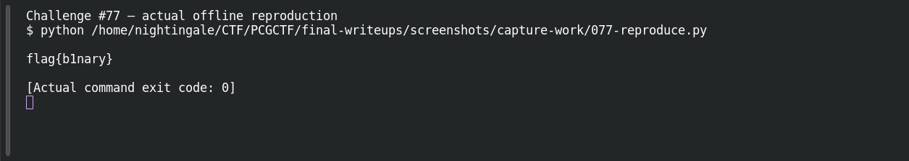
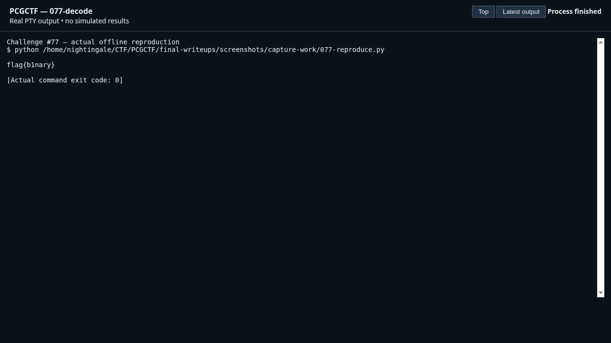

# Hit a Brick Wall

**Platform:** PCGCTF · **Challenge ID:** 77 · **Category:** Forensics · **Points:** 100

**Status:** Independently decoded during this review. Exact PCGCTF submission not re-confirmed.

## The challenge

Recover the message hidden in a wall of bricks.

## Solving it

The bricks encode bits by colour — two brick colours standing in for 0 and 1. Reading the wall left-to-right as binary and decoding the bytes as ASCII:

```text
brick colours → 01100010 01 ... → "b1nary"
```

The message is `b1nary`.

## Screenshots





## Flag

```text
pcgCTF{b1nary}
```

## Takeaway

A two-state visual pattern (brick colours, lights, tiles) is usually binary — map the two states to 0/1, read in order, and decode as ASCII.

## Reference

- [Original challenge description](../../unsolved/forensics/077-hit-a-brick-wall/README.md)
