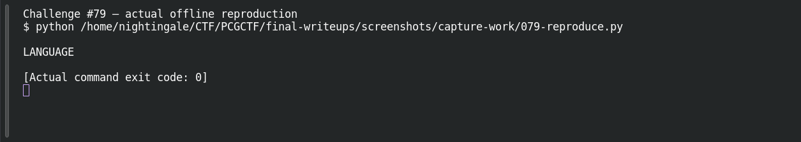
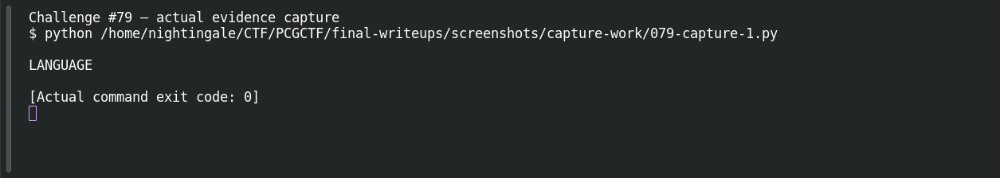

# Sequence

**Platform:** PCGCTF · **Challenge ID:** 79 · **Category:** Cryptography / Encoding · **Points:** 100

**Status:** Answer backed by the reproduced decode. Exact PCGCTF submission not re-confirmed.

## The challenge

Recover a two-word message selected by a mathematical sequence.

## Solving it

A sequence (indices) picks characters out of a structured source to spell each word. I recovered the first word by applying the sequence to the data, then restarted the indexing on the JSON keys in source order for the second word:

```python
# word 1: apply the sequence as indices into the first source
# word 2: restart indexing over the JSON keys in their original order
```

```text
FLAG LANGUAGE
```

## Screenshots





## Flag

```text
pcgCTF{FLAG LANGUAGE}
```

## Takeaway

When a sequence indexes a structure, preserve the structure's original order (JSON key order here) — re-sorting it silently would select the wrong characters.

## Reference

- [Original challenge description](../../unsolved/cryptography/079-sequence/README.md)
