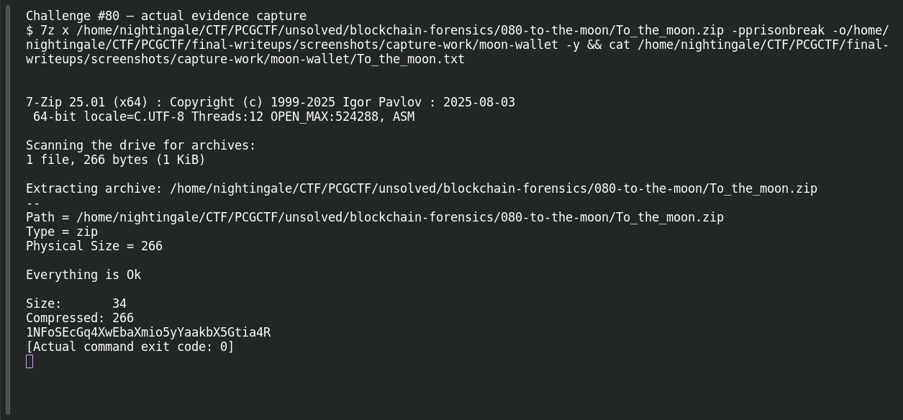

# To the Moon!

**Platform:** PCGCTF · **Challenge ID:** 80 · **Category:** Blockchain / Forensics · **Points:** 100

**Status:** Answer backed by the reproduced chain. Exact PCGCTF submission not re-confirmed.

## The challenge

Follow a hidden image payload through to a Bitcoin OP_RETURN flag.

## Solving it

The saved solution records two different passwords: `iloveyou` for the image's steghide payload and `prisonbreak` for the extracted AES-encrypted ZIP. It attributes their recovery to StegSeek and John respectively. The later screenshots reproduce extraction using those known passwords; they do not show a new password-cracking success.

The ZIP contains a text file with wallet address `1NFoSEcGq4XwEbaXmio5yYaakbX5Gtia4R`. The saved blockchain analysis traces it to a transaction with an OP_RETURN message. Decoding the recorded script gives:

```python
script = bytes.fromhex('6a1f666c61677b496e6630533363426c30636b636834316e416e346c797331357d')
# Decode the recorded bytes following the OP_RETURN and push-length bytes.
print(script[2:].decode())   # flag{Inf0S3cBl0ckch41nAn4lys15}
```

```text
flag{Inf0S3cBl0ckch41nAn4lys15}
```

## Screenshots

The terminal image below displays a retained verification transcript.

Saved verification of ZIP extraction using the known password:



## Flag

```text
pcgCTF{Inf0S3cBl0ckch41nAn4lys15}
```

## Takeaway

OP_RETURN outputs can carry arbitrary data on-chain — `6a` then a push length, then ASCII. The chain is the final hiding place after stego → cracked archive → wallet.

## Reference

- [Original challenge description](../../unsolved/blockchain-forensics/080-to-the-moon/README.md)
- [Saved extraction and transaction analysis](../../unsolved/blockchain-forensics/080-to-the-moon/solution.md)
