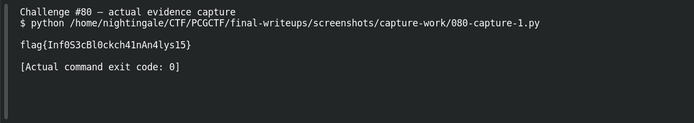
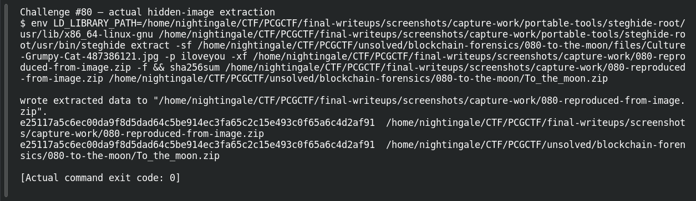

# TO THE MOON!

| Field | Details |
|---|---|
| Platform | PCGCTF |
| Challenge ID | 80 |
| Technical category | Blockchain / Forensics |
| Points in saved inventory | 150 |
| Difficulty | Not stated in the saved challenge description |
| Objective | Follow the hidden image payload to a Bitcoin OP_RETURN flag. |
| Result | `pcgCTF{Inf0S3cBl0ckch41nAn4lys15}` |

**Needs Flag Verification:** the answer is supported by the evidence described below, but its exact submission has not been confirmed accepted by PCGCTF.

## Reading the clues

The image is a carrier for an archive, which contains a wallet. Each recovered layer gives the next step; jumping straight to a public flag would hide the actual evidence chain.

## Working through the evidence

### 1. Extract the steganographic payload

The supplied Grumpy Cat JPEG contains a steghide payload. The preserved StegSeek dictionary run recovers password **iloveyou** and an embedded file **To_the_moon.zip** (266 bytes). Those are challenge passwords intentionally needed to reproduce this educational artifact, not unrelated account credentials.

### 2. Open the encrypted archive

The archive uses AES-256. The recorded John workflow recovers ZIP password **prisonbreak**; its text member contains the wallet **1NFoSEcGq4XwEbaXmio5yYaakbX5Gtia4R**. Keep the wallet’s case exactly: Base58 address spelling is not safely lowercased.

The originalsolution and evidence retain the extraction/cracking steps and outputs. A repeat should point the tools at the suppliedJPEG and recoveredZIP, not at an unrelated examplecarrier; no new cracking success is invented in this drafting pass.

The archive layer was independently repeated during the final review with the retained recovered ZIP:

```sh
7z x '/home/nightingale/CTF/PCGCTF/unsolved/blockchain-forensics/080-to-the-moon/To_the_moon.zip' -pprisonbreak -o'/home/nightingale/CTF/PCGCTF/final-writeups/evidence/080/reproduced-wallet' -y
```

`x` extracts paths, `-p` supplies the challenge archive password, `-o` selects a new local output directory, and `-y` accepts overwrite prompts for this reproduction output. The actual run returned “Everything is Ok”, one 34-byte text member containing `1NFoSEcGq4XwEbaXmio5yYaakbX5Gtia4R`. [Repeated extracted member](../evidence/080/reproduced-wallet/To_the_moon.txt).

The screenshot pass also repeated the carrier extraction with the verified password `iloveyou`. A workspace-only copy of steghide from the official Parrot package repository extracted the ZIP from the original JPEG; SHA-256 comparison matched the retained archive. The capture and actual command log below preserve that run. This repeats extraction with the known password; the earlier password-cracking result remains attributed to the preserved investigation.

### 3. Inspect the recorded transaction’s script

Transaction e22990a8494a2c22c8ab68c6288164fb084885ca3dad68b149da9e296ec67af5, output 1, contains scripthex:

```text
6a1f666c61677b496e6630533363426c30636b636834316e416e346c797331357d
```

6a is OP_RETURN, and 1f pushes 31 bytes. Decode only that payload:

```python
script = bytes.fromhex('6a1f666c61677b496e6630533363426c30636b636834316e416e346c797331357d')
assert script[0] == 0x6a and len(script[2:]) == script[1]
print(script[2:].decode('ascii'))
```

Actual recovered text: **flag{Inf0S3cBl0ckch41nAn4lys15}**. The saved raw transaction check also recomputes the txid. The PCGCTF candidate substitutes only the prefix required by the local prompt and retains every payload character.

### Reproduction inputs and preserved output

Use the original artifact links below to replace any angle-bracketed input path. Those placeholders select local files; they are not missing exploit parameters. Commands in this draft explain a recorded method and should be checked against the preserved hashes before rerunning. The linked original investigation retains additional tool output and exact filenames; where a result is reported above, its verification record is linked rather than invented as a terminal screenshot.

## Captured screenshots and evidence

Captured on 2026-10-29 from actual terminal sessions or browser views. Captions distinguish new results, preserved records, source images and blockers. No platform acceptance is inferred from these images.

### Challenge #80 — actual evidence capture



Run the documented self-contained decoder/calculation on original inputs.

Command/action actually executed:

```sh
python /home/nightingale/CTF/PCGCTF/final-writeups/screenshots/capture-work/080-capture-1.py
```

[Actual command transcript](../screenshots/capture-work/080-script-1.terminal.log) · [Execution record](../screenshots/capture-work/080-script-1.result.json). Notice the result fields discussed in the corresponding solution step; the transcript retains lines that extend beyond the screenshot viewport.

### Challenge #80 — actual evidence capture


Actually extract the retained encrypted CTF ZIP and read wallet text.

Command/action actually executed:

```sh
7z x /home/nightingale/CTF/PCGCTF/unsolved/blockchain-forensics/080-to-the-moon/To_the_moon.zip -pprisonbreak -o/home/nightingale/CTF/PCGCTF/final-writeups/screenshots/capture-work/moon-wallet -y && cat /home/nightingale/CTF/PCGCTF/final-writeups/screenshots/capture-work/moon-wallet/To_the_moon.txt
```

[Actual command transcript](../screenshots/capture-work/080-zip.terminal.log) · [Execution record](../screenshots/capture-work/080-zip.result.json). Notice the result fields discussed in the corresponding solution step; the transcript retains lines that extend beyond the screenshot viewport.

### Challenge #80 — actual hidden-image extraction



Actual steghide extraction using the verified challenge password; hashes compared to the earlier retained ZIP. Workspace-only official package, no system installation.

Command/action actually executed:

```sh
env LD_LIBRARY_PATH=/home/nightingale/CTF/PCGCTF/final-writeups/screenshots/capture-work/portable-tools/steghide-root/usr/lib/x86_64-linux-gnu /home/nightingale/CTF/PCGCTF/final-writeups/screenshots/capture-work/portable-tools/steghide-root/usr/bin/steghide extract -sf /home/nightingale/CTF/PCGCTF/unsolved/blockchain-forensics/080-to-the-moon/files/Culture-Grumpy-Cat-487386121.jpg -p iloveyou -xf /home/nightingale/CTF/PCGCTF/final-writeups/screenshots/capture-work/080-reproduced-from-image.zip -f && sha256sum /home/nightingale/CTF/PCGCTF/final-writeups/screenshots/capture-work/080-reproduced-from-image.zip /home/nightingale/CTF/PCGCTF/unsolved/blockchain-forensics/080-to-the-moon/To_the_moon.zip
```

[Actual command transcript](../screenshots/capture-work/080-carrier-proof.terminal.log) · [Execution record](../screenshots/capture-work/080-carrier-proof.result.json). Notice the result fields discussed in the corresponding solution step; the transcript retains lines that extend beyond the screenshot viewport.

## Flag discovery and final verification

The saved submission candidate is **`pcgCTF{Inf0S3cBl0ckch41nAn4lys15}`**. Carrierpayload,wallet,rawscriptlength andflag are locally/source-verified in retained evidence; PCGCTF wrapper acceptance is not.

The remaining platform check is to open the specific PCGCTF challenge, copy the documented payload with its exact capitalization, spaces and punctuation, and capture the real acceptance or rejection response. No successful submission is inferred from the existence of the answer. If rejected, record the response and compare the stated format before changing the evidence-backed payload.

## What this challenge taught me

A layered evidence chain connects carrier, archive, wallet and script. Document each boundary and verify the on-chain bytes.

## Evidence and references

[Original archived challenge](../../unsolved/blockchain-forensics/080-to-the-moon/README.md)

- [Decisive preserved verification results](../../analysis-blockchain-forensics/verification.json)
- [Preserved investigation notes](../../unsolved/blockchain-forensics/080-to-the-moon/solution.md)

**Provenance:** Original local artifacts and preserved independent extraction/source verification; drafted without claiming new live attacks or fabricated executions.
