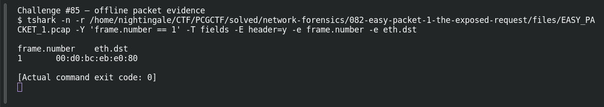

# EASY PACKET 1 #03 — Destination at Layer 2

**Platform:** PCGCTF · **Challenge ID:** 85 · **Category:** Network Forensics · **Points:** 100

**Status:** Answer backed by the capture (`EASY_PACKET_1.pcap`). Exact PCGCTF submission not re-confirmed.

## The challenge

Read the destination Ethernet MAC.

## Solving it

```sh
tshark -nr EASY_PACKET_1.pcap -T fields -e eth.dst
```

```text
00:d0:bc:eb:e0:80
```

That's the layer-2 destination. The flag uses dash-separated uppercase.

## Screenshot



## Flag

```text
pcgCTF{00-D0-BC-EB-E0-80}
```

## Reference

- [Original challenge description](../../solved/network-forensics/085-easy-packet-1-03-destination-at-layer-2/README.md)
