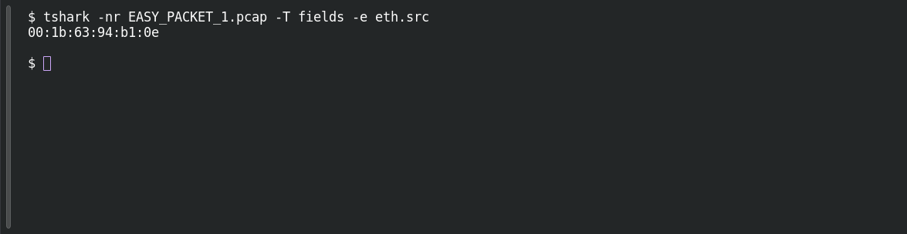

# EASY PACKET 1 #04 — Source at Layer 2

**Platform:** PCGCTF · **Challenge ID:** 86 · **Category:** Network Forensics · **Points:** 100

**Status:** Answer backed by the capture (`EASY_PACKET_1.pcap`). Exact PCGCTF submission not re-confirmed.

## The challenge

Read the source Ethernet MAC.

## Solving it

```sh
tshark -nr EASY_PACKET_1.pcap -T fields -e eth.src
```

```text
00:1b:63:94:b1:0e
```

The layer-2 source, again dash-separated uppercase in the flag.

## Screenshot

Fresh local reproduction using the command described above.



## Flag

```text
pcgCTF{00-1B-63-94-B1-0E}
```

## Reference

- [Original challenge description](../../unsolved/network-forensics/086-easy-packet-1-04-source-at-layer-2/README.md)
