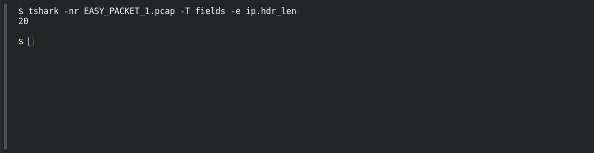

# EASY PACKET 1 #07 — The 20-Byte Header

**Platform:** PCGCTF · **Challenge ID:** 89 · **Category:** Network Forensics · **Points:** 100

**Status:** Answer backed by the capture (`EASY_PACKET_1.pcap`). Exact PCGCTF submission not re-confirmed.

## The challenge

Give the IPv4 header length in bytes.

## Solving it

```sh
tshark -nr EASY_PACKET_1.pcap -T fields -e ip.hdr_len
```

```text
20
```

20 bytes — a standard IPv4 header with no options.

## Screenshot

Fresh local reproduction using the command described above.



## Flag

```text
pcgCTF{20 bytes}
```

## Reference

- [Original challenge description](../../unsolved/network-forensics/089-easy-packet-1-07-the-20-byte-header/README.md)
