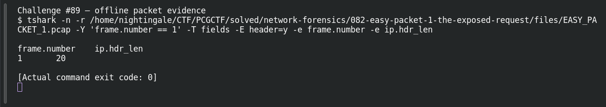

# EASY PACKET 1 #07  The 20-Byte Header

| Item | Record |
|---|---|
| Platform | PCGCTF |
| Challenge ID | 89 |
| Category | Network Forensics |
| Points | 100 |
| Difficulty | Not separately recorded in the available inventory |
| Verification | Needs Flag Verification — the answer has offline evidence, but our PCGCTF snapshot does not record acceptance. A teammate’s reported acceptance, where noted, is separate evidence. |

## Challenge and objective

Determine the IPv4 header length in bytes.

The original description and prerequisite chain are preserved in [the challenge README](../../unsolved/network-forensics/089-easy-packet-1-07-the-20-byte-header/README.md). The supplied evidence is `EASY_PACKET_1.pcap`; related storyline questions reuse the same capture rather than providing another download.

## Initial analysis

IPv4 stores IHL as a count of 32-bit words, so reading a raw IHL nibble of 5 is only the first step. The question asks for bytes.

I kept the original capture intact and used offline packet analysis. The file’s SHA-256 is `e4735559a704fcd56ac790602e875a713f94a665af16ecd3ad49ea40ff394faa`. This identifies the exact evidence behind the frame references; no reconstructed program was executed and no request was sent to an address found inside the capture.

## Step-by-step solution

### 1. Select the field at the correct protocol layer

Wireshark’s ip.hdr_len already applies the conversion: five words multiplied by four bytes gives 20 bytes. This is the IPv4 header only; the Ethernet and TCP headers are separate.

```sh
tshark -n \
  -r /home/nightingale/CTF/PCGCTF/solved/network-forensics/082-easy-packet-1-the-exposed-request/files/EASY_PACKET_1.pcap \
  -Y 'frame.number == 1' \
  -T fields -E header=y -e frame.number -e ip.hdr_len
```

`-n` disables address/name resolution so that recorded numeric addresses stay visible. `-r` reads the existing capture, and `-Y` applies a display filter after decoding. `-T fields` outputs selected fields; each `-e` adds one named column, and `-E header=y` records the column names. `frame.number == 1` is appropriate because the independent capture count is one; it is not being used to prove that count.

**Actual reproduced output** (tab-separated; full lines are preserved in the linked TSV):

```text
frame.number	ip.hdr_len
1	20
```

### 2. Interpret the result

Garcia reports that 20 bytes is accepted and bare 20 is rejected. The candidate therefore retains the unit. This is a reported formatting result, not a new submission from our account.

## Captured screenshots and evidence

Captured on 2026-10-29 from actual terminal sessions or browser views. Captions distinguish new results, preserved records, source images and blockers. No platform acceptance is inferred from these images.

### Challenge #89 — offline packet evidence



Fresh execution of the draft’s field-specific TShark command.

Command/action actually executed:

```sh
tshark -n -r /home/nightingale/CTF/PCGCTF/solved/network-forensics/082-easy-packet-1-the-exposed-request/files/EASY_PACKET_1.pcap -Y 'frame.number == 1' -T fields -E header=y -e frame.number -e ip.hdr_len
```

[Actual command transcript](../screenshots/capture-work/089-network.terminal.log) · [Execution record](../screenshots/capture-work/089-network.result.json). Notice the result fields discussed in the corresponding solution step; the transcript retains lines that extend beyond the screenshot viewport.

## Flag discovery and verification

Saved submission candidate:

```text
pcgCTF{20 bytes}
```

Needs Flag Verification — the answer has offline evidence, but our PCGCTF snapshot does not record acceptance. A teammate’s reported acceptance, where noted, is separate evidence. Garcia’s Day 1 document explicitly reports this submission spelling accepted; it was not independently retested in our account. The exact wrapper comes from the challenge’s `pcgCTF{...}` requirement; literal spaces, capitalization and separators are retained as recorded. The focused final check is to submit this exact saved spelling when the platform is available and preserve the resulting acceptance or rejection with the challenge ID.

## Conclusion and lesson

Track units through a calculation. The raw encoded field, interpreted byte count and final answer string need not be identical. The artifact-backed answer and the platform acceptance state remain separate in this draft.

## Reproduction evidence and references

- [Original challenge description](../../unsolved/network-forensics/089-easy-packet-1-07-the-20-byte-header/README.md)
- [Actual TShark field output](../evidence/network/089-fields.tsv)
- [Commands, hashes and reproduction results](../evidence/network/reproduction.json)
- [TShark version](../evidence/network/tshark-version.txt)
- [TShark official manual](https://www.wireshark.org/docs/man-pages/tshark.html)

- [Earlier local solution and provenance](../../unsolved/network-forensics/089-easy-packet-1-07-the-20-byte-header/solution.md)

- [Garcia Day 1 report — attributed formatting/acceptance evidence](../../team-writeups/garcia-day1/source.md)
