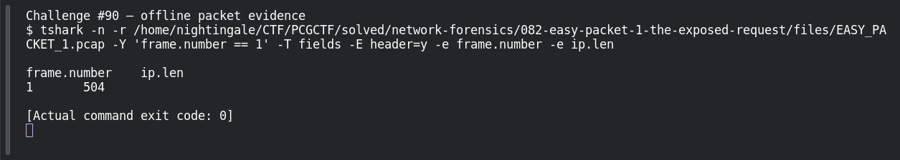

# EASY PACKET 1 #08 — Total Packet Weight

**Platform:** PCGCTF · **Challenge ID:** 90 · **Category:** Network Forensics · **Points:** 100

**Status:** Answer backed by the capture (`EASY_PACKET_1.pcap`). Exact PCGCTF submission not re-confirmed.

## The challenge

Read the IPv4 total-length field.

## Solving it

```sh
tshark -nr EASY_PACKET_1.pcap -T fields -e ip.len
```

```text
504
```

504 bytes — that's the IP total length (header + payload).

## Screenshot



## Flag

```text
pcgCTF{504 bytes}
```

## Reference

- [Original challenge description](../../solved/network-forensics/090-easy-packet-1-08-total-packet-weight/README.md)
