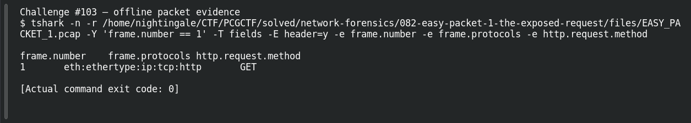

# EASY PACKET 1 #21  Speak HTTP

| Item | Record |
|---|---|
| Platform | PCGCTF |
| Challenge ID | 103 |
| Category | Network Forensics |
| Points | 100 |
| Difficulty | Not separately recorded in the available inventory |
| Verification | Needs Flag Verification — the answer has offline evidence, but our PCGCTF snapshot does not record acceptance. A teammate’s reported acceptance, where noted, is separate evidence. |

## Challenge and objective

Identify the application-layer protocol visible in the packet.

The original description and prerequisite chain are preserved in [the challenge README](../../unsolved/network-forensics/103-easy-packet-1-21-speak-http/README.md). The supplied evidence is `EASY_PACKET_1.pcap`; related storyline questions reuse the same capture rather than providing another download.

## Initial analysis

I checked the payload rather than deriving the application protocol solely from port 80. A readable request line is stronger evidence than a customary port number.

I kept the original capture intact and used offline packet analysis. The file’s SHA-256 is `e4735559a704fcd56ac790602e875a713f94a665af16ecd3ad49ea40ff394faa`. This identifies the exact evidence behind the frame references; no reconstructed program was executed and no request was sent to an address found inside the capture.

## Step-by-step solution

### 1. Select the field at the correct protocol layer

The protocol stack includes HTTP and the payload begins with GET /statuses/replies.xml HTTP/1.1. The Host and Authorization headers belong to that same request.

```sh
tshark -n \
  -r /home/nightingale/CTF/PCGCTF/solved/network-forensics/082-easy-packet-1-the-exposed-request/files/EASY_PACKET_1.pcap \
  -Y 'frame.number == 1' \
  -T fields -E header=y -e frame.number -e frame.protocols -e http.request.method
```

`-n` disables address/name resolution so that recorded numeric addresses stay visible. `-r` reads the existing capture, and `-Y` applies a display filter after decoding. `-T fields` outputs selected fields; each `-e` adds one named column, and `-E header=y` records the column names. `frame.number == 1` is appropriate because the independent capture count is one; it is not being used to prove that count.

**Actual reproduced output** (tab-separated; full lines are preserved in the linked TSV):

```text
frame.number	frame.protocols	http.request.method
1	eth:ethertype:ip:tcp:http	GET
```

### 2. Interpret the result

The answer is HTTP. TCP is its transport here, and IPv4 carries that transport; those are valid layers but do not answer the application-layer question.

## Captured screenshots and evidence

Captured on 2026-10-29 from actual terminal sessions or browser views. Captions distinguish new results, preserved records, source images and blockers. No platform acceptance is inferred from these images.

### Challenge #103 — offline packet evidence



Fresh execution of the draft’s field-specific TShark command.

Command/action actually executed:

```sh
tshark -n -r /home/nightingale/CTF/PCGCTF/solved/network-forensics/082-easy-packet-1-the-exposed-request/files/EASY_PACKET_1.pcap -Y 'frame.number == 1' -T fields -E header=y -e frame.number -e frame.protocols -e http.request.method
```

[Actual command transcript](../screenshots/capture-work/103-network.terminal.log) · [Execution record](../screenshots/capture-work/103-network.result.json). Notice the result fields discussed in the corresponding solution step; the transcript retains lines that extend beyond the screenshot viewport.

## Flag discovery and verification

Saved submission candidate:

```text
pcgCTF{HTTP}
```

Needs Flag Verification — the answer has offline evidence, but our PCGCTF snapshot does not record acceptance. A teammate’s reported acceptance, where noted, is separate evidence. The exact wrapper comes from the challenge’s `pcgCTF{...}` requirement; literal spaces, capitalization and separators are retained as recorded. The focused final check is to submit this exact saved spelling when the platform is available and preserve the resulting acceptance or rejection with the challenge ID.

## Conclusion and lesson

Use syntax and dissector evidence to distinguish the application protocol from its lower layers. The artifact-backed answer and the platform acceptance state remain separate in this draft.

## Reproduction evidence and references

- [Original challenge description](../../unsolved/network-forensics/103-easy-packet-1-21-speak-http/README.md)
- [Actual TShark field output](../evidence/network/103-fields.tsv)
- [Commands, hashes and reproduction results](../evidence/network/reproduction.json)
- [TShark version](../evidence/network/tshark-version.txt)
- [TShark official manual](https://www.wireshark.org/docs/man-pages/tshark.html)

- [Earlier local solution and provenance](../../unsolved/network-forensics/103-easy-packet-1-21-speak-http/solution.md)
