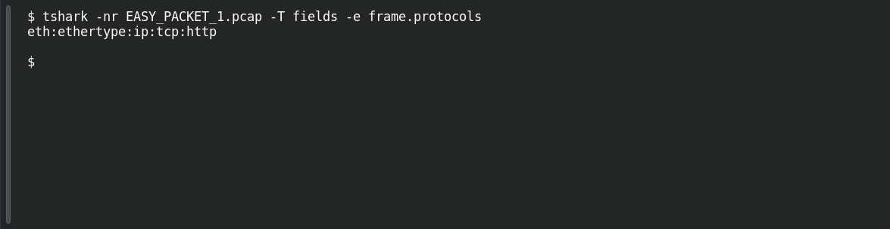

# EASY PACKET 1 #21 — Speak HTTP

**Platform:** PCGCTF · **Challenge ID:** 103 · **Category:** Network Forensics · **Points:** 100

**Status:** Answer backed by the capture (`EASY_PACKET_1.pcap`). Exact PCGCTF submission not re-confirmed.

## The challenge

Name the application-layer protocol.

## Solving it

```sh
tshark -nr EASY_PACKET_1.pcap -T fields -e frame.protocols
```

```text
eth:ethertype:ip:tcp:http
```

The protocol stack ends in `http` (a GET request), so the app-layer protocol is HTTP.

## Screenshot

Fresh local reproduction using the command described above.



## Flag

```text
pcgCTF{HTTP}
```

## Reference

- [Original challenge description](../../unsolved/network-forensics/103-easy-packet-1-21-speak-http/README.md)
