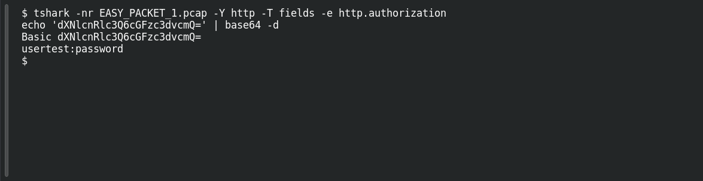

# EASY PACKET 1 #29 — The Exposed Credentials

**Platform:** PCGCTF · **Challenge ID:** 111 · **Category:** Network Forensics · **Points:** 100

**Status:** Answer backed by the capture (`EASY_PACKET_1.pcap`). Exact PCGCTF submission not re-confirmed.

## The challenge

Recover the credentials from the Basic auth header.

## Solving it

```sh
tshark -nr EASY_PACKET_1.pcap -Y http -T fields -e http.authorization
echo 'dXNlcnRlc3Q6cGFzc3dvcmQ=' | base64 -d
```

```text
Basic dXNlcnRlc3Q6cGFzc3dvcmQ=
usertest:password
```

Decoded, it's `usertest:password`. This challenge's flag joins them with a slash.

## Screenshot

Fresh local reproduction using the command described above.



## Flag

```text
pcgCTF{usertest/password}
```

## Reference

- [Original challenge description](../../unsolved/network-forensics/111-easy-packet-1-29-the-exposed-credentials/README.md)
