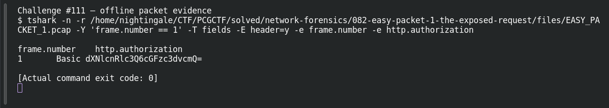

# EASY PACKET 1 #29  The Exposed Credentials

| Item | Record |
|---|---|
| Platform | PCGCTF |
| Challenge ID | 111 |
| Category | Network Forensics |
| Points | 100 |
| Difficulty | Not separately recorded in the available inventory |
| Verification | Needs Flag Verification — the answer has offline evidence, but our PCGCTF snapshot does not record acceptance. A teammate’s reported acceptance, where noted, is separate evidence. |

## Challenge and objective

Recover the username and password encoded in the Basic header.

The original description and prerequisite chain are preserved in [the challenge README](../../unsolved/network-forensics/111-easy-packet-1-29-the-exposed-credentials/README.md). The supplied evidence is `EASY_PACKET_1.pcap`; related storyline questions reuse the same capture rather than providing another download.

## Initial analysis

The input is the token after Basic. Copying the entire header into a Base64 decoder would mix ordinary scheme text with the encoded credential bytes.

I kept the original capture intact and used offline packet analysis. The file’s SHA-256 is `e4735559a704fcd56ac790602e875a713f94a665af16ecd3ad49ea40ff394faa`. This identifies the exact evidence behind the frame references; no reconstructed program was executed and no request was sent to an address found inside the capture.

## Step-by-step solution

### 1. Inspect the relevant HTTP fields

The token dXNlcnRlc3Q6cGFzc3dvcmQ= decodes to usertest:password. Splitting at the first colon gives username usertest and password password.

```sh
tshark -n \
  -r /home/nightingale/CTF/PCGCTF/solved/network-forensics/082-easy-packet-1-the-exposed-request/files/EASY_PACKET_1.pcap \
  -Y 'frame.number == 1' \
  -T fields -E header=y -e frame.number -e http.authorization
```

`-n` disables address/name resolution so that recorded numeric addresses stay visible. `-r` reads the existing capture, and `-Y` applies a display filter after decoding. `-T fields` outputs selected fields; each `-e` adds one named column, and `-E header=y` records the column names. `frame.number == 1` is appropriate because the independent capture count is one; it is not being used to prove that count.

**Actual reproduced output** (tab-separated; full lines are preserved in the linked TSV):

```text
frame.number	http.authorization
1	Basic dXNlcnRlc3Q6cGFzc3dvcmQ=
```

### 2. Interpret the result

Garcia explicitly reports usertest/password as the accepted CTF string. That slash belongs to the grader’s requested answer representation; the actual HTTP Basic payload still contains a colon.

### Decode the Basic credential token

```sh
python - <<'PY'
import base64
token = 'dXNlcnRlc3Q6cGFzc3dvcmQ='
print(base64.b64decode(token, validate=True).decode('ascii'))
PY
```

The string is the token captured after `Basic`, not a guessed password. `validate=True` rejects malformed Base64 instead of silently ignoring invalid characters, and ASCII decoding makes the resulting credential delimiters explicit. Independently reproduced result:

```text
usertest:password
```

The username is `usertest` and the password is `password`. These are challenge-provided demonstration credentials recovered from the supplied capture. The result leads directly to the answer; no login attempt against Twitter or any external service is necessary. The scheme’s representation and TLS requirement are described in [RFC 7617](https://www.rfc-editor.org/rfc/rfc7617.html).

## Captured screenshots and evidence

Captured on 2026-10-29 from actual terminal sessions or browser views. Captions distinguish new results, preserved records, source images and blockers. No platform acceptance is inferred from these images.

### Challenge #111 — offline packet evidence



Fresh execution of the draft’s field-specific TShark command.

Command/action actually executed:

```sh
tshark -n -r /home/nightingale/CTF/PCGCTF/solved/network-forensics/082-easy-packet-1-the-exposed-request/files/EASY_PACKET_1.pcap -Y 'frame.number == 1' -T fields -E header=y -e frame.number -e http.authorization
```

[Actual command transcript](../screenshots/capture-work/111-network.terminal.log) · [Execution record](../screenshots/capture-work/111-network.result.json). Notice the result fields discussed in the corresponding solution step; the transcript retains lines that extend beyond the screenshot viewport.

## Flag discovery and verification

Saved submission candidate:

```text
pcgCTF{usertest/password}
```

Needs Flag Verification — the answer has offline evidence, but our PCGCTF snapshot does not record acceptance. A teammate’s reported acceptance, where noted, is separate evidence. Garcia’s Day 1 document explicitly reports this submission spelling accepted; it was not independently retested in our account. The exact wrapper comes from the challenge’s `pcgCTF{...}` requirement; literal spaces, capitalization and separators are retained as recorded. The focused final check is to submit this exact saved spelling when the platform is available and preserve the resulting acceptance or rejection with the challenge ID.

## Conclusion and lesson

Preserve the difference between a decoded artifact and a submission string. That distinction explains why a correct decode may have failed a grader. The artifact-backed answer and the platform acceptance state remain separate in this draft.

## Reproduction evidence and references

- [Original challenge description](../../unsolved/network-forensics/111-easy-packet-1-29-the-exposed-credentials/README.md)
- [Actual TShark field output](../evidence/network/111-fields.tsv)
- [Commands, hashes and reproduction results](../evidence/network/reproduction.json)
- [TShark version](../evidence/network/tshark-version.txt)
- [TShark official manual](https://www.wireshark.org/docs/man-pages/tshark.html)

- [Earlier local solution and provenance](../../unsolved/network-forensics/111-easy-packet-1-29-the-exposed-credentials/solution.md)

- [Garcia Day 1 report — attributed formatting/acceptance evidence](../../team-writeups/garcia-day1/source.md)
