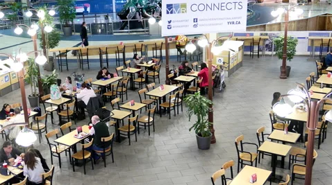
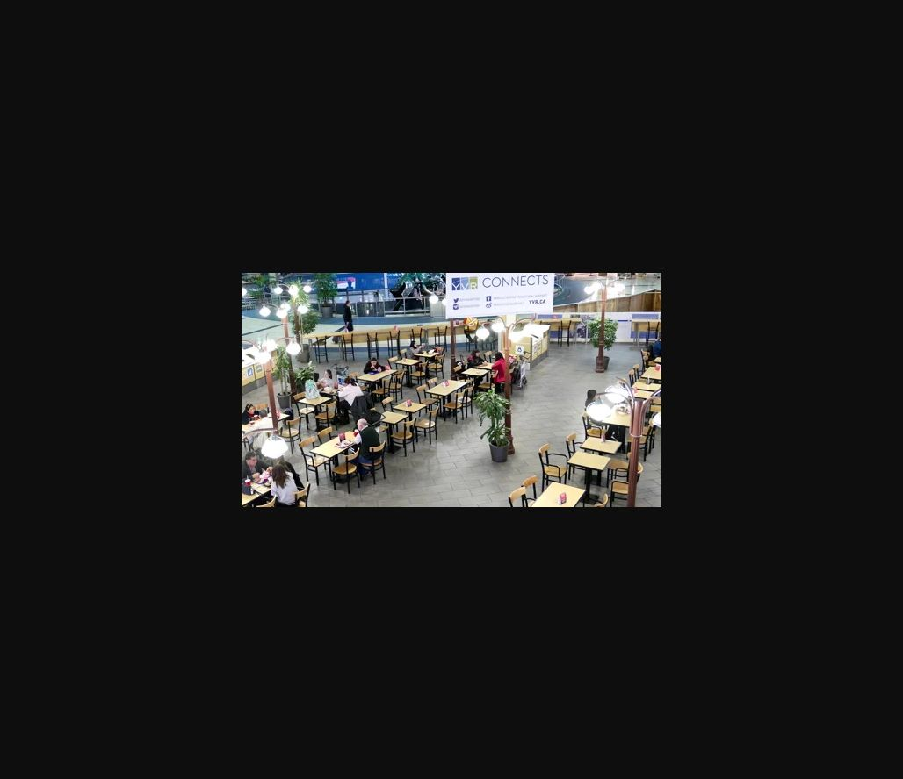

# Airport Context — Building

| Field | Details |
|---|---|
| Platform | PCGCTF |
| Challenge ID | 244 |
| Technical category | OSINT / IMINT |
| Points in saved inventory | 100 |
| Difficulty | Not stated in the saved challenge description |
| Objective | Identify the airport building from the visible signage. |
| Result | `pcgCTF{Vancouver International Airport}` |

**Needs Flag Verification:** the answer is supported by the evidence described below, but its exact submission has not been confirmed accepted by PCGCTF.

## Reading the clues

The strongest clue is text in the photograph, not the general appearance of a food court. The banner reads YVR CONNECTS and includes YVR.CA. These two independent uses of the same code make a targeted official-site lookup more useful than a broad reverse-image search.

## Working through the evidence

### 1. Read the branding before guessing a location

Open the original photograph at full resolution and zoom into the overhead sign. Record **YVR CONNECTS** and **YVR.CA** separately from generic restaurant names. An airport code can be used by unrelated businesses, so the code is a lead rather than the entire proof.

### 2. Resolve that clue with the institution’s own site

The [official YVR airport page](https://www.yvr.ca/en/about-yvr) identifies the institution as **Vancouver International Airport**. The saved verification pairs that official naming with the exact branding visible in the supplied image.

This narrows the answer to the building requested by the challenge. A precise terminal, gate, or restaurant is unnecessary and would introduce unsupported detail.

### 3. Keep the evidence roles distinct

The supplied photograph supplies the YVR clue; the airport's own page supplies the expanded name. A browser comparison is the meaningful procedure here. Metadata extraction is an optional check for GPS, but no GPS coordinate is needed or claimed as the basis of this solution.

The linked primary/reference pages were checked during the preserved 2026-10-28 verification. They are cited as that recorded research, not as a new claim about any later live page.

## Visual evidence

*Original airport photograph with YVR branding.* Place after the first step; box YVR CONNECTS and YVR.CA. Keep the surrounding interior visible so the sign remains tied to the supplied scene.

## Captured screenshots and evidence

Captured on 2026-10-29 from actual terminal sessions or browser views. Captions distinguish new results, preserved records, source images and blockers. No platform acceptance is inferred from these images.

### 244-actual-browser-image.png

Original supplied image displayed in the browser; identification context only, not an independent acceptance record.

## Flag discovery and final verification

The saved submission candidate is **`pcgCTF{Vancouver International Airport}`**. The building name is supported. Exact grader capitalization and spacing have not been tested.

The remaining platform check is to open the specific PCGCTF challenge, copy the documented payload with its exact capitalization, spaces and punctuation, and capture the real acceptance or rejection response. No successful submission is inferred from the existence of the answer. If rejected, record the response and compare the stated format before changing the evidence-backed payload.

## What this challenge taught me

Readable institutional branding can solve a geolocation problem without coordinates. A short identifier becomes convincing when it is connected to an authoritative expansion of the name.

## Evidence and references

[Original archived challenge](../../unsolved/osint-imint/244-airport-context-building/README.md)

- [Preserved source checks and input hashes](../../unsolved/osint-imint/244-airport-context-building/evidence/verification.json)
- [Preserved investigation notes](../../unsolved/osint-imint/244-airport-context-building/solution.md)

**Provenance:** Original image/video and recorded independent visual/source comparison; rewritten from the preserved verification notes without inventing a historical search transcript.
