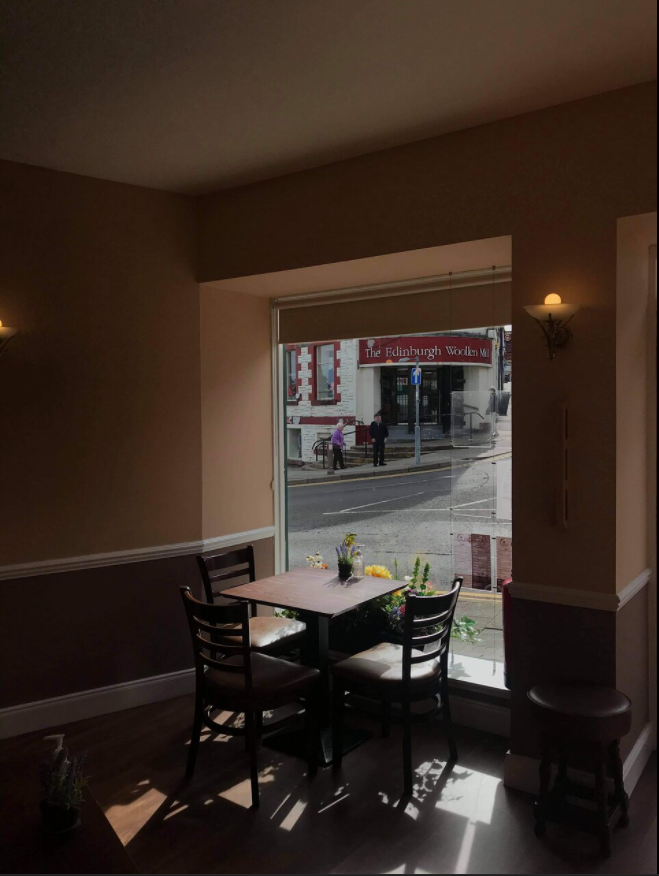
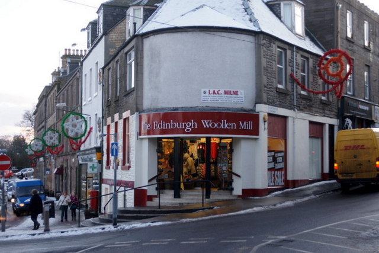
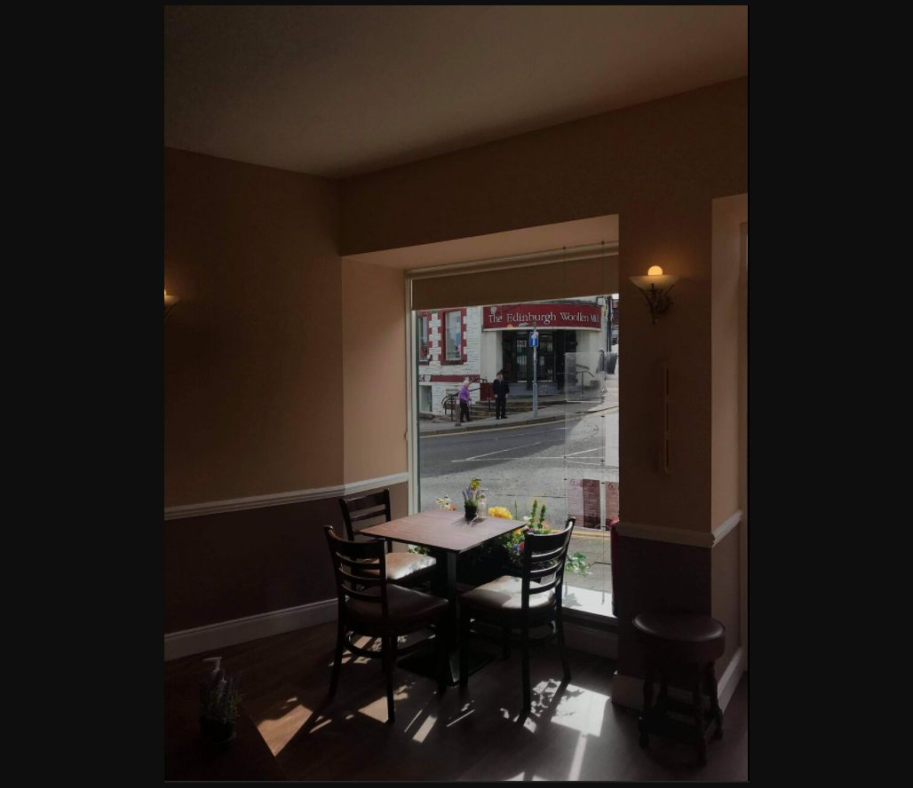

# Coffee Shop — City

| Field | Details |
|---|---|
| Platform | PCGCTF |
| Challenge ID | 247 |
| Technical category | OSINT / IMINT |
| Points in saved inventory | 100 |
| Difficulty | Not stated in the saved challenge description |
| Objective | Determine the Scottish town or city containing the photographed coffee shop. |
| Result | `pcgCTF{Blairgowrie}` |

**Needs Flag Verification:** the answer is supported by the evidence described below, but its exact submission has not been confirmed accepted by PCGCTF.

## Reading the clues

The useful clue lies outside the café window. The white corner building with red trim carries The Edinburgh Woollen Mill branding. The chain name alone is not unique; the geometry of this specific storefront supplies the more discriminating evidence.

## Working through the evidence

### 1. Inventory the visible exterior details

The original photo shows a corner entrance, red fascia and quoins, red-trimmed windows, a blue traffic sign and railing. Recording several stable features avoids treating one common chain name as a unique location.

### 2. Match the exact branch to an independent photograph

Mike Pennington's [geotagged photograph of the Blairgowrie branch](https://www.geograph.org.uk/photo/1647585) reproduces the same corner layout and façade details. The saved reference image lets the two views be compared without relying only on a search result caption.

### 3. Cross-check the street context

The [local heritage record](https://www.ourheritageblairrattray.scot/timeline/the-well-meadow-architecture) places the branch at 20 Wellmeadow, Blairgowrie. The [local tourism listing for The Wee Coffee Shop](https://www.discoverblairgowrie.co.uk/blairgowrie-and-rattray-businesses/the-wee-coffee-shop) places the café at 1 Allan Street in the same town.

Together these explain why a photograph taken inside the café shows that shopfront outside. The requested result is **Blairgowrie**, not Edinburgh simply because the chain includes “Edinburgh” in its name. The location is supported by a visual match and local records; the supplied image has no GPS evidence recorded.

The linked primary/reference pages were checked during the preserved 2026-10-28 verification. They are cited as that recorded research, not as a new claim about any later live page.

## Visual evidence

*Original coffee-shop view toward the opposite corner.* Box the red-and-white storefront and its relationship to the sign and railing.

*Mike Pennington’s reference photograph of the Blairgowrie branch.* Place alongside the original-view discussion; number matching entrance, corner trim and fascia features. Preserve attribution before publication.

## Captured screenshots and evidence

Captured on 2026-10-29 from actual terminal sessions or browser views. Captions distinguish new results, preserved records, source images and blockers. No platform acceptance is inferred from these images.

### 247-actual-browser-image.png

Original supplied image displayed in the browser; identification context only, not an independent acceptance record.

## Flag discovery and final verification

The saved submission candidate is **`pcgCTF{Blairgowrie}`**. The town is supported by the matched façade and independent local records. The platform’s exact accepted flag spelling remains untested.

The remaining platform check is to open the specific PCGCTF challenge, copy the documented payload with its exact capitalization, spaces and punctuation, and capture the real acceptance or rejection response. No successful submission is inferred from the existence of the answer. If rejected, record the response and compare the stated format before changing the evidence-backed payload.

## What this challenge taught me

A business name can be misleading as a place name. Cross-matching architecture and street furniture prevents the obvious chain-brand clue from becoming an unsupported city guess.

## Evidence and references

[Original archived challenge](../../unsolved/osint-imint/247-coffee-shop-city/README.md)

- [Preserved source checks and input hashes](../../unsolved/osint-imint/247-coffee-shop-city/evidence/verification.json)
- [Reference-image attribution](../../unsolved/osint-imint/247-coffee-shop-city/evidence/REFERENCE_ATTRIBUTION.md)
- [Preserved investigation notes](../../unsolved/osint-imint/247-coffee-shop-city/solution.md)

**Provenance:** Original image/video and recorded independent visual/source comparison; rewritten from the preserved verification notes without inventing a historical search transcript.
