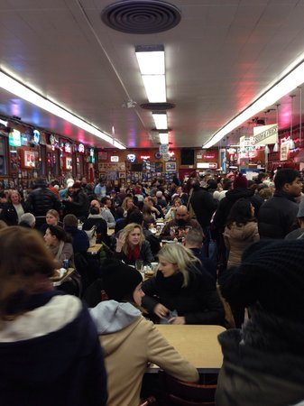

# Reverse Image — Editor

| Field | Details |
|---|---|
| Platform | PCGCTF |
| Challenge ID | 253 |
| Technical category | OSINT / IMINT |
| Points in saved inventory | 100 |
| Difficulty | Not stated in the saved challenge description |
| Objective | Name the Bon Appétit editor who worked the restaurant’s 24-hour experience. |
| Result | `pcgCTF{Andrew Knowlton}` |

**Needs Flag Verification:** the answer is supported by the evidence described below, but its exact submission has not been confirmed accepted by PCGCTF.

## Reading the clues

This question has no separate attachment. It depends on the restaurant image in challenge #252, which shows Katz’s Delicatessen. The wording asks for an editor, so identifying the restaurant again would only complete the prerequisite.

## Working through the evidence

### 1. Resolve the shared restaurant evidence

Use the archived restaurant image from #252 to establish the Katz's Delicatessen context. Keep that dependency explicit rather than pretending a new image is attached to this challenge.

### 2. Search the publisher’s own video record

Bon Appétit's [original video page](https://www.bonappetit.com/video/watch/working-24-hours-straight-at-new-york-most-iconic-deli) describes **Andrew Knowlton** working a 24-hour shift at Katz's Delicatessen in New York City. This directly connects all three elements in the prompt: restaurant, duration and editor.

The [publisher’s Andrew Knowlton profile](https://www.bonappetit.com/person/andrew-knowlton) provides an independent role/name check within the same primary publisher. The saved verification records both sources.

### 3. Extract the person’s name, not the video title

The final answer is `Andrew Knowlton`. The title and restaurant are supporting context rather than material to append to the flag. There is no need to guess a name from a video thumbnail when the publisher supplies the attribution.

The linked primary/reference pages were checked during the preserved 2026-10-28 verification. They are cited as that recorded research, not as a new claim about any later live page.

## Visual evidence

*Shared restaurant photograph from #252.* Place before the publisher lookup; identify the Katz’s context without claiming this is a separate #253 attachment.

## Captured screenshots and evidence

Captured on 2026-10-29 from actual terminal sessions or browser views. Captions distinguish new results, preserved records, source images and blockers. No platform acceptance is inferred from these images.

### 253-actual-browser-image.png

Original supplied image displayed in the browser; identification context only, not an independent acceptance record.

## Flag discovery and final verification

The saved submission candidate is **`pcgCTF{Andrew Knowlton}`**. The editor name is corroborated by the primary publisher. Exact platform acceptance is untested.

The remaining platform check is to open the specific PCGCTF challenge, copy the documented payload with its exact capitalization, spaces and punctuation, and capture the real acceptance or rejection response. No successful submission is inferred from the existence of the answer. If rejected, record the response and compare the stated format before changing the evidence-backed payload.

## What this challenge taught me

A chained OSINT challenge can change the type of answer while keeping the same artifact. After locating a place, a primary publisher record can identify the associated person more reliably than a loosely matched image search.

## Evidence and references

[Original archived challenge](../../unsolved/osint-imint/253-reverse-image-editor/README.md)

- [Preserved source checks and input hashes](../../unsolved/osint-imint/253-reverse-image-editor/evidence/verification.json)
- [Preserved investigation notes](../../unsolved/osint-imint/253-reverse-image-editor/solution.md)

**Provenance:** Original image/video and recorded independent visual/source comparison; rewritten from the preserved verification notes without inventing a historical search transcript.
