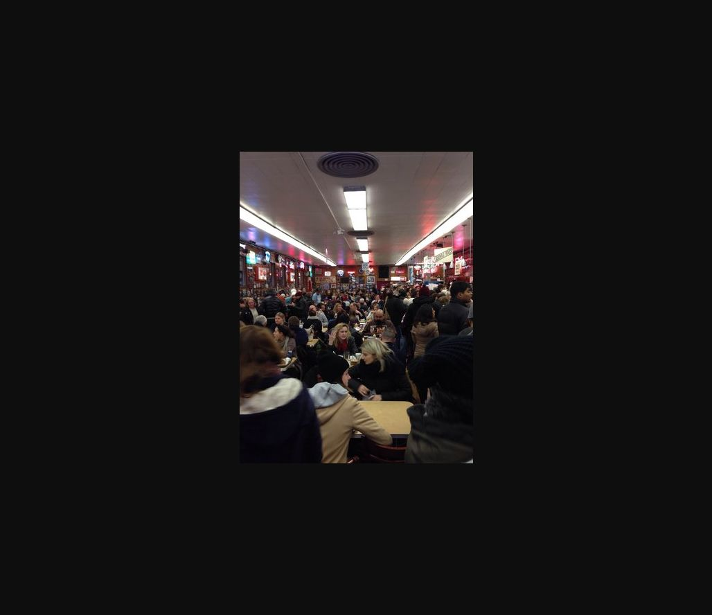

# Reverse Image — Editor

**Platform:** PCGCTF · **Challenge ID:** 253 · **Category:** OSINT / IMINT · **Points:** 100

**Status:** Answer backed by the publisher's own video. Exact PCGCTF submission not re-confirmed. (Builds on restaurant ID #252.)

## The challenge

Name the Bon Appétit editor who worked the restaurant's 24-hour experience.

## Solving it

Restaurant #252 identified the place as Katz's Delicatessen. Bon Appétit's own video — "Working 24 Hours Straight at NY's Most Iconic Deli" — names the editor, which ties together all three clues (restaurant + 24-hour + editor):

```text
Bon Appétit video → Andrew Knowlton, 24-hour shift at Katz's
Bon Appétit staff profile → Andrew Knowlton (confirms name/role)
```

## Screenshot



## Flag

```text
pcgCTF{Andrew Knowlton}
```

## Takeaway

Extract the person's *name* from the primary source, not the video title — and confirm with the publisher's own staff profile.

## References

- [Bon Appétit video](https://www.bonappetit.com/video/watch/working-24-hours-straight-at-new-york-most-iconic-deli)
- [Original challenge description](../../unsolved/osint-imint/253-reverse-image-editor/README.md)
