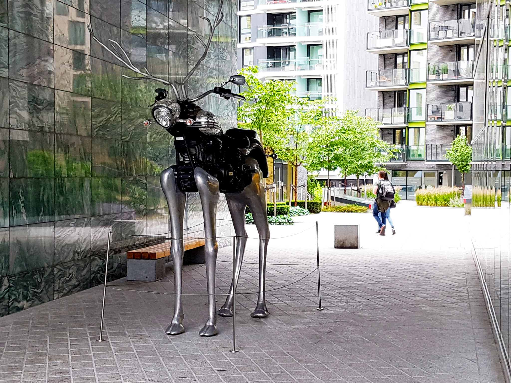
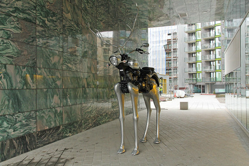

# Sculpture — Identification

| Field | Details |
|---|---|
| Platform | PCGCTF |
| Challenge ID | 254 |
| Technical category | OSINT / IMINT |
| Points in saved inventory | 100 |
| Difficulty | Not stated in the saved challenge description |
| Objective | Identify the title of the motorcycle-and-reindeer sculpture. |
| Result | `pcgCTF{Rudolph the Chrome Nosed Reindeer}` |

**Needs Flag Verification:** the answer is supported by the evidence described below, but its exact submission has not been confirmed accepted by PCGCTF.

## Reading the clues

The sculpture has an unusual combination of features: a motorcycle body, reindeer-like head and four elongated metal legs. Those features are more distinctive than the surrounding apartment buildings and make a visual-reference comparison appropriate.

## Working through the evidence

### 1. Describe the object before assigning a title

The original image places the long-legged motorcycle sculpture in a green stone entrance court. Those physical features give a useful search description while the surrounding walls and outlook provide a way to reject near-matches.

### 2. Compare an independently attributed photograph

Perry Tak's [Tjuvholmen photograph](https://www.flickr.com/photos/meteorry/12995187234) shows the same sculpture and entrance-court setting. The front of the motorcycle, long metallic legs, green walls and building outlook agree with the supplied image. The saved reference photograph preserves this comparison.

### 3. Verify the title with the artist’s record

[Magne Furuholmen’s official biography](https://magnefuruholmen.com/biography/) lists **Rudolph The Chrome Nosed Reindeer** among the Apparatjik installations. This is stronger evidence for the title spelling than assuming how a familiar Christmas name should be hyphenated.

The candidate uses `Rudolph the Chrome Nosed Reindeer`. The lower-case article follows the saved answer; the artist's title supplies the word sequence. No guessed installation year is needed to answer this question.

The linked primary/reference pages were checked during the preserved 2026-10-28 verification. They are cited as that recorded research, not as a new claim about any later live page.

## Visual evidence

*Supplied motorcycle-reindeer sculpture.* Place after the feature inventory; number the motorcycle body, long legs and green court.

*Perry Tak’s matching Tjuvholmen reference photograph.* Align the numbered visual features with the original; retain the photographer attribution.

## Captured screenshots and evidence

Captured on 2026-10-29 from actual terminal sessions or browser views. Captions distinguish new results, preserved records, source images and blockers. No platform acceptance is inferred from these images.

### 254-actual-browser-image.png

Original supplied image displayed in the browser; identification context only, not an independent acceptance record.

## Flag discovery and final verification

The saved submission candidate is **`pcgCTF{Rudolph the Chrome Nosed Reindeer}`**. The object and title are independently supported. Article capitalization and grader normalization remain untested.

The remaining platform check is to open the specific PCGCTF challenge, copy the documented payload with its exact capitalization, spaces and punctuation, and capture the real acceptance or rejection response. No successful submission is inferred from the existence of the answer. If rejected, record the response and compare the stated format before changing the evidence-backed payload.

## What this challenge taught me

Visual identification and title verification are separate steps. A photograph can establish that the object matches, while an artist’s own record is better evidence for the name to transcribe.

## Evidence and references

[Original archived challenge](../../unsolved/osint-imint/254-sculpture-identification/README.md)

- [Preserved source checks and input hashes](../../unsolved/osint-imint/254-sculpture-identification/evidence/verification.json)
- [Reference-image attribution](../../unsolved/osint-imint/254-sculpture-identification/evidence/REFERENCE_ATTRIBUTION.md)
- [Preserved investigation notes](../../unsolved/osint-imint/254-sculpture-identification/solution.md)

**Provenance:** Original image/video and recorded independent visual/source comparison; rewritten from the preserved verification notes without inventing a historical search transcript.
