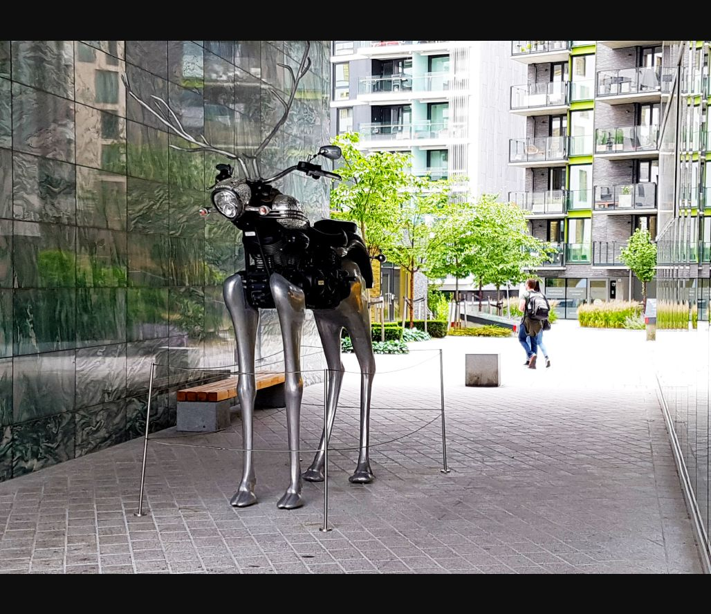

# Sculpture — Identification

**Platform:** PCGCTF · **Challenge ID:** 254 · **Category:** OSINT / IMINT · **Points:** 100

**Status:** Answer backed by matched photo + artist record. Exact PCGCTF submission not re-confirmed.

## The challenge

Name the motorcycle-and-reindeer sculpture.

## Solving it

The sculpture's features are unmistakable — a motorcycle body, a reindeer-like head and four long metal legs — which made a visual-reference match the right move. A geotagged photo from Tjuvholmen (Oslo) shows the same piece and courtyard, and the artist's record gives the title:

```text
Matched photo (Tjuvholmen) → same sculpture + setting
Title: Rudolph the Chrome Nosed Reindeer
```

## Screenshot



## Flag

```text
pcgCTF{Rudolph the Chrome Nosed Reindeer}
```

## Takeaway

Lead with the object's distinctive features, not the surrounding buildings — then confirm the title against the artist's own record.

## References

- [Tjuvholmen photograph](https://www.flickr.com/photos/meteorry/12995187234)
- [Original challenge description](../../unsolved/osint-imint/254-sculpture-identification/README.md)
