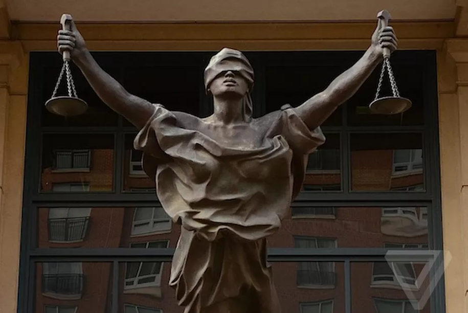
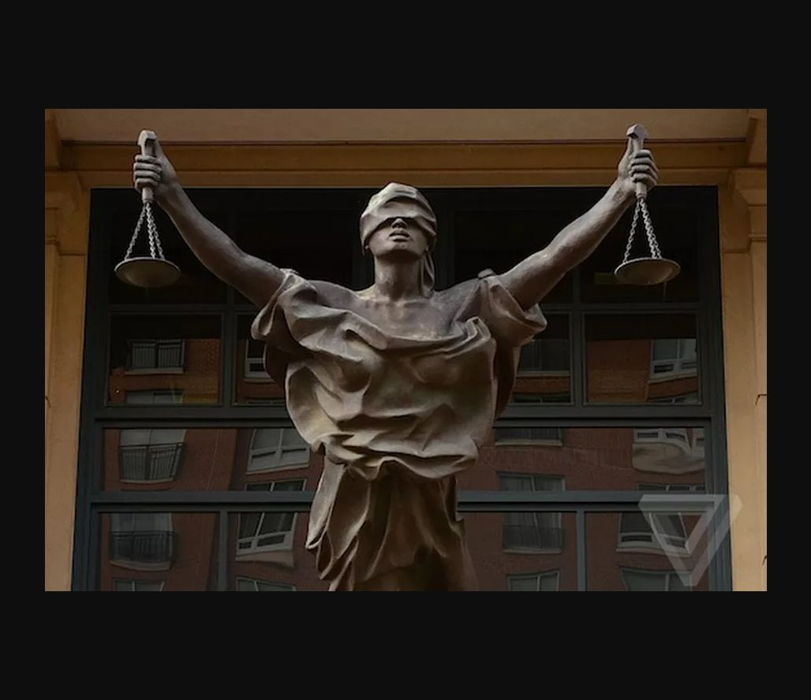

# Justice — Character

| Field | Details |
|---|---|
| Platform | PCGCTF |
| Challenge ID | 256 |
| Technical category | OSINT / IMINT |
| Points in saved inventory | 100 |
| Difficulty | Not stated in the saved challenge description |
| Objective | Identify the character represented by the blindfolded scales-bearing statue. |
| Result | `pcgCTF{Lady Justice}` |

**Needs Flag Verification:** the answer is supported by the evidence described below, but its exact submission has not been confirmed accepted by PCGCTF.

## Reading the clues

The prompt asks for the depicted character rather than the artwork title. The blindfold and scales are recognizable justice attributes, but the photograph still needs a matching institutional record so that a generic iconographic guess does not replace object identification.

## Working through the evidence

### 1. Record the statue’s distinctive pose

The supplied image shows a blindfolded woman, raised arms, scales in both hands and billowing robes, with courthouse windows behind her. These details distinguish the object from many other Justice statues.

### 2. Confirm the physical object

The [U.S. General Services Administration artwork record](https://art.gsa.gov/objects/21667/justice-delayed-justice-denied) identifies the sculpture at A. V. Bryan U.S. Courthouse as **Justice Delayed, Justice Denied**, by Raymond Kaskey. Its description confirms the blindfolded Justice figure and paired scales.

Tim Evanson's [original photograph](https://www.flickr.com/photos/timevanson/6830726642) supplies a further visual match: facial features, hand grips, scales and drapery agree. The saved reference image documents this comparison.

### 3. Answer at the level requested

For the character, the saved answer is **Lady Justice**. `Justice Delayed, Justice Denied` is the artwork's title, not the requested character. Substituting Themis without evidence that the grader asks for that classical name would introduce unnecessary uncertainty.

The linked primary/reference pages were checked during the preserved 2026-10-28 verification. They are cited as that recorded research, not as a new claim about any later live page.

## Visual evidence

*Original scales-bearing Justice figure.* Box the blindfold and both sets of scales; keep the pose visible.

*Tim Evanson’s matching statue photograph.* Use matching numbers on the blindfold, hand grips and drapery; preserve attribution.

## Captured screenshots and evidence

Captured on 2026-10-29 from actual terminal sessions or browser views. Captions distinguish new results, preserved records, source images and blockers. No platform acceptance is inferred from these images.

### 256-actual-browser-image.png

Original supplied image displayed in the browser; identification context only, not an independent acceptance record.

## Flag discovery and final verification

The saved submission candidate is **`pcgCTF{Lady Justice}`**. The character identification is supported, while the platform’s accepted wording has not been confirmed.

The remaining platform check is to open the specific PCGCTF challenge, copy the documented payload with its exact capitalization, spaces and punctuation, and capture the real acceptance or rejection response. No successful submission is inferred from the existence of the answer. If rejected, record the response and compare the stated format before changing the evidence-backed payload.

## What this challenge taught me

Knowing what a question asks for matters as much as recognizing the image. Character, artwork title, artist and location are related facts, but they are not interchangeable flag payloads.

## Evidence and references

[Original archived challenge](../../unsolved/osint-imint/256-justice-character/README.md)

- [Preserved source checks and input hashes](../../unsolved/osint-imint/256-justice-character/evidence/verification.json)
- [Reference-image attribution](../../unsolved/osint-imint/256-justice-character/evidence/REFERENCE_ATTRIBUTION.md)
- [Preserved investigation notes](../../unsolved/osint-imint/256-justice-character/solution.md)

**Provenance:** Original image/video and recorded independent visual/source comparison; rewritten from the preserved verification notes without inventing a historical search transcript.
