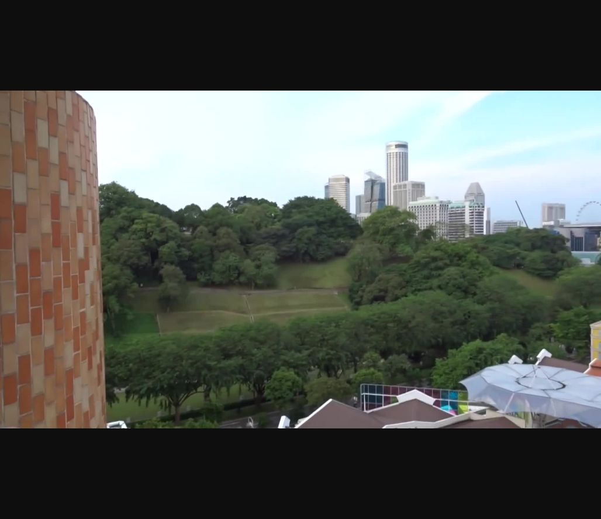

# Hotel From the Past

**Platform:** PCGCTF · **Challenge ID:** 259 · **Category:** OSINT / IMINT · **Points:** 100

**Status:** Answer backed by the owner's filings. Exact PCGCTF submission not re-confirmed.

## The challenge

Identify the former hotel visible in the supplied Singapore video.

## Solving it

I pulled a frame with good architectural context (the gold/orange tower over Clarke Quay) and matched it against the owner's annual report. CDL Hospitality Trusts' 2019 report (p.65) shows the same tower and names it:

```text
CDLHT AR19 p.65 → Novotel Singapore Clarke Quay (views toward Fort Canning Park)
Name history: "New Otani" was an earlier name for the same property
```

The hotel is Novotel Singapore Clarke Quay. (Its operations were reported ceasing in early April 2020 — correcting a teammate's approximate 2021 note.)

## Screenshot



## Flag

```text
pcgCTF{Novotel Singapore Clarke Quay}
```

## Takeaway

Match the building to the owner's own filing, and keep the property's name history straight — an earlier name (New Otani) isn't what the "former hotel" question is after here.

## References

- [CDLHT 2019 annual report](https://links.sgx.com/1.0.0/corporate-announcements/0AEJA5FHMB9YXN5I/606133_CDLHT%20AR19%20Final.pdf)
- [Original challenge description](../../unsolved/osint-imint/259-hotel-from-the-past/README.md)
