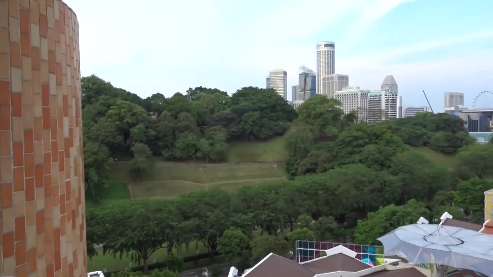
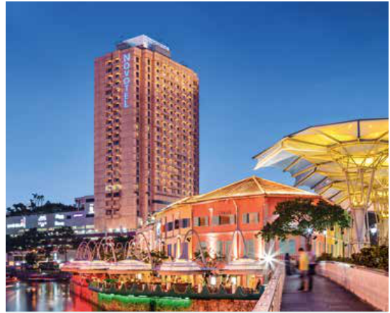

# Hotel From the Past

| Field | Details |
|---|---|
| Platform | PCGCTF |
| Challenge ID | 259 |
| Technical category | OSINT / IMINT |
| Points in saved inventory | 100 |
| Difficulty | Not stated in the saved challenge description |
| Objective | Identify the former hotel visible in the supplied Singapore video. |
| Result | `pcgCTF{Novotel Singapore Clarke Quay}` |

**Needs Flag Verification:** the answer is supported by the evidence described below, but its exact submission has not been confirmed accepted by PCGCTF.

## Reading the clues

A video can contain a more useful view than its opening frame. The saved frame at five seconds shows a distinctive orange/gold façade, Fort Canning’s sloped lawn and Clarke Quay roofs. The phrase “former hotel” makes a historical owner record more useful than a current hotel booking page.

## Working through the evidence

### 1. Extract a frame that preserves the architectural context

The recorded extraction uses FFmpeg at approximately five seconds. A reproduction command is:

```sh
ffmpeg -ss 5 -i '<ORIGINAL_TASK9_VIDEO>' -frames:v 1 hotel-context-00m05s.jpg
```

Replace the placeholder with the original video linked below. `-ss 5` selects a position five seconds into it, while `-frames:v 1` writes a single still frame. The existing evidence image is the observed result; the command above is a recipe, not a claim of a newly captured screenshot.

### 2. Compare the building against its owner’s report

CDL Hospitality Trusts' [2019 annual report](https://links.sgx.com/1.0.0/corporate-announcements/0AEJA5FHMB9YXN5I/606133_CDLHT%20AR19%20Final.pdf), printed page 65 (PDF page 67), names **Novotel Singapore Clarke Quay** and shows the same gold/orange tower above Clarke Quay. Its description mentions views toward Fort Canning Park, corroborating the direction in the video.

### 3. Keep the historical names straight

The [owner’s transaction circular](https://links.sgx.com/FileOpen/CDLHT-Circular.030120.ashx?App=Prospectus&FileID=41766) records the property's name history. New Otani was an earlier name; the matching Novotel property is the answer saved here. The annual report says operations would cease in early **April 2020**, correcting the teammate's approximate 2021 claim.

The original description supplies no recording date, so the architectural match and owner documentation are the reliable basis. The scene does not by itself prove an exact filming date.

The linked primary/reference pages were checked during the preserved 2026-10-28 verification. They are cited as that recorded research, not as a new claim about any later live page.

## Visual evidence



*Observed five-second frame from the supplied video.* Box the gold/orange façade and label Fort Canning’s lawn and Clarke Quay roofs.



*Owner-report photograph naming Novotel Singapore Clarke Quay.* Place after the owner comparison. Box the matching tower and the hotel name; the source page is printed p. 65.

## Captured screenshots and evidence

Captured on 2026-10-29 from actual terminal sessions or browser views. Captions distinguish new results, preserved records, source images and blockers. No platform acceptance is inferred from these images.

### 259-actual-browser-image.png


Original supplied image displayed in the browser; identification context only, not an independent acceptance record.

## Flag discovery and final verification

The saved submission candidate is **`pcgCTF{Novotel Singapore Clarke Quay}`**. The Novotel identity is supported; the recording date and exact grader normalization remain untested.

The remaining platform check is to open the specific PCGCTF challenge, copy the documented payload with its exact capitalization, spaces and punctuation, and capture the real acceptance or rejection response. No successful submission is inferred from the existence of the answer. If rejected, record the response and compare the stated format before changing the evidence-backed payload.

## What this challenge taught me

Historical geolocation requires a time-aware source. The same site can carry several names, so matching architecture first and then checking owner records prevents a current or earlier brand from being substituted casually.

## Evidence and references

[Original archived challenge](../../unsolved/osint-imint/259-hotel-from-the-past/README.md)

- [Preserved source checks and input hashes](../../unsolved/osint-imint/259-hotel-from-the-past/evidence/verification.json)
- [Original supplied video](../../unsolved/osint-imint/259-hotel-from-the-past/files/task9_1602643917499.mp4)
- [Preserved investigation notes](../../unsolved/osint-imint/259-hotel-from-the-past/solution.md)

**Provenance:** Original image/video and recorded independent visual/source comparison; rewritten from the preserved verification notes without inventing a historical search transcript.
