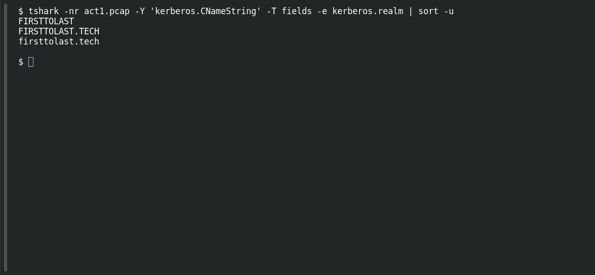

# ACT 1 — First Signal: Domain Membership

**Platform:** PCGCTF · **Challenge ID:** 265 · **Category:** Network Forensics · **Points:** 100

**Status:** Answer backed by the Act 1 capture. Exact PCGCTF submission not independently re-confirmed.

## The challenge

What Active Directory domain is the compromised workstation joined to?

## Solving it

Use [the shared capture](../../solved/network-forensics/262-act-1-first-signal-patient-zero/files/ACT12026-08-09-traffic-analysis-exercise.pcap) as `act1.pcap` for the commands below.

The Kerberos realm is the domain, straight from the AS-REQ:

```sh
tshark -nr act1.pcap -Y 'kerberos.CNameString' -T fields -e kerberos.realm | sort -u
```

```text
FIRSTTOLAST
FIRSTTOLAST.TECH
firsttolast.tech
```

The realm is `FIRSTTOLAST.TECH`; the NetBIOS/short domain name is `FIRSTTOLAST`.

## Screenshot

Fresh local reproduction using the command described above.



## Flag

```text
pcgCTF{FIRSTTOLAST}
```

(If the grader wanted the full realm it'd be `FIRSTTOLAST.TECH` — worth noting since both appear.)

## Takeaway

The Kerberos realm names the domain. Watch whether a challenge wants the short name or the full DNS realm.

## Reference

- [Original challenge description](../../unsolved/network-forensics/265-act-1-first-signal-domain-membership/README.md)
