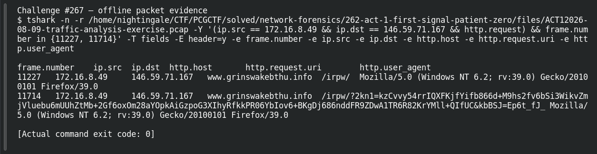

# ACT 1 - FIRST SIGNAL: Calling Home

| Item | Record |
|---|---|
| Platform | PCGCTF |
| Challenge ID | 267 |
| Category | Network Forensics |
| Points | 125 |
| Difficulty | Not separately recorded in the available inventory |
| Verification | Needs Flag Verification — the answer has offline evidence, but our PCGCTF snapshot does not record acceptance. A teammate’s reported acceptance, where noted, is separate evidence. |

## Challenge and objective

Identify one confirmed C2 IPv4 address contacted by the compromised host.

The original description and prerequisite chain are preserved in [the challenge README](../../unsolved/network-forensics/267-act-1-first-signal-calling-home/README.md). The supplied evidence is `ACT12026-08-09-traffic-analysis-exercise.pcap`; related storyline questions reuse the same capture rather than providing another download.

## Initial analysis

I kept the known victim as the source and inspected repeated HTTP behavior, rather than treating an unfamiliar destination as automatically malicious.

I kept the original capture intact and used offline packet analysis. The file’s SHA-256 is `0ea6b597732a9ce6af9a7e3adff4512c9a91b4bce27184c8fdeb746f05cce170`. This identifies the exact evidence behind the frame references; no reconstructed program was executed and no request was sent to an address found inside the capture.

## Step-by-step solution

### 1. Narrow the incident to a reproducible evidence set

The discovery filter for this question is:

```wireshark
ip.src == 172.16.8.49 && ip.dst == 146.59.71.167 && http.request
```

In Wireshark, the filter removes unrelated frames from the display without deleting them from the file. For a command-line reproduction, the following extraction additionally selects the cited frames where appropriate:

```sh
tshark -n \
  -r /home/nightingale/CTF/PCGCTF/solved/network-forensics/262-act-1-first-signal-patient-zero/files/ACT12026-08-09-traffic-analysis-exercise.pcap \
  -Y '(ip.src == 172.16.8.49 && ip.dst == 146.59.71.167 && http.request) && frame.number in {11227, 11714}' \
  -T fields -E header=y -e frame.number -e ip.src -e ip.dst -e http.host -e http.request.uri -e http.user_agent
```

`-n` disables address/name resolution so that recorded numeric addresses stay visible. `-r` reads the existing capture, and `-Y` applies a display filter after decoding. `-T fields` outputs selected fields; each `-e` adds one named column, and `-E header=y` records the column names. The `frame.number in {...}` clause makes the final evidence small and auditable; the wider discovery filter remains documented above.

**Actual reproduced output** (tab-separated; full lines are preserved in the linked TSV):

```text
frame.number	ip.src	ip.dst	http.host	http.request.uri	http.user_agent
11227	172.16.8.49	146.59.71.167	www.grinswakebthu.info	/irpw/	Mozilla/5.0 (Windows NT 6.2; rv:39.0) Gecko/20100101 Firefox/39.0
11714	172.16.8.49	146.59.71.167	www.grinswakebthu.info	/irpw/?2kn1=kzCvvy54rrIQXFKjfYifb866d+M9hs2fv6bSi3WikvZmjVluebu6mUUhZtMb+2Gf6oxOm28aYOpkAiGzpoG3XIhyRfkkPR06YbIov6+BKgDj686nddFR9ZDwA1TR6R82KrYMll+QIfUC&kbBSJ=Ep6t_fJ_	Mozilla/5.0 (Windows NT 6.2; rv:39.0) Gecko/20100101 Firefox/39.0
```

### 2. Interpret the result

The same source 172.16.8.49 sends /irpw/ requests to 146.59.71.167 with Host www.grinswakebthu.info. Frame 11714 adds a FormBook-shaped check-in query and the Firefox/39.0 user-agent profile. The previous investigation compared the structure with official ET Open SID 2050745; this is structural rule corroboration, not a claim that an IDS engine was run.

## Captured screenshots and evidence

Captured on 2026-10-29 from actual terminal sessions or browser views. Captions distinguish new results, preserved records, source images and blockers. No platform acceptance is inferred from these images.

### Challenge #267 — offline packet evidence



Fresh execution of the draft’s field-specific TShark command.

Command/action actually executed:

```sh
tshark -n -r /home/nightingale/CTF/PCGCTF/solved/network-forensics/262-act-1-first-signal-patient-zero/files/ACT12026-08-09-traffic-analysis-exercise.pcap -Y '(ip.src == 172.16.8.49 && ip.dst == 146.59.71.167 && http.request) && frame.number in {11227, 11714}' -T fields -E header=y -e frame.number -e ip.src -e ip.dst -e http.host -e http.request.uri -e http.user_agent
```

[Actual command transcript](../screenshots/capture-work/267-network.terminal.log) · [Execution record](../screenshots/capture-work/267-network.result.json). Notice the result fields discussed in the corresponding solution step; the transcript retains lines that extend beyond the screenshot viewport.

## Flag discovery and verification

Saved submission candidate:

```text
pcgCTF{146.59.71.167}
```

Needs Flag Verification — the answer has offline evidence, but our PCGCTF snapshot does not record acceptance. A teammate’s reported acceptance, where noted, is separate evidence. The exact wrapper comes from the challenge’s `pcgCTF{...}` requirement; literal spaces, capitalization and separators are retained as recorded. The focused final check is to submit this exact saved spelling when the platform is available and preserve the resulting acceptance or rejection with the challenge ID.

## Conclusion and lesson

A defensible C2 attribution combines source, destination and application behavior. A bare external IP is insufficient. The artifact-backed answer and the platform acceptance state remain separate in this draft.

## Reproduction evidence and references

- [Original challenge description](../../unsolved/network-forensics/267-act-1-first-signal-calling-home/README.md)
- [Actual TShark field output](../evidence/network/267-fields.tsv)
- [Commands, hashes and reproduction results](../evidence/network/reproduction.json)
- [TShark version](../evidence/network/tshark-version.txt)
- [TShark official manual](https://www.wireshark.org/docs/man-pages/tshark.html)

- [Earlier local solution and provenance](../../unsolved/network-forensics/267-act-1-first-signal-calling-home/solution.md)
