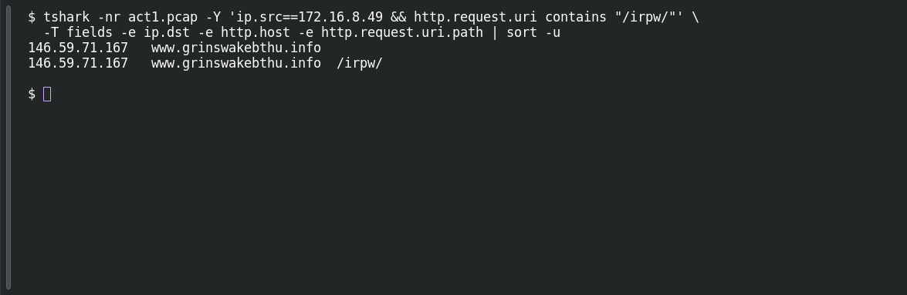

# ACT 1 — First Signal: Calling Home

**Platform:** PCGCTF · **Challenge ID:** 267 · **Category:** Network Forensics · **Points:** 100

**Status:** Answer backed by the Act 1 capture. Exact PCGCTF submission not independently re-confirmed.

**Evidence:** Packets 11227, 11714 · TCP streams 242, 249 · [ACT12026-08-09-traffic-analysis-exercise.pcap](../../solved/network-forensics/262-act-1-first-signal-patient-zero/files/ACT12026-08-09-traffic-analysis-exercise.pcap).

## The challenge

Name one confirmed C2 IPv4 address the compromised host contacted.

## Solving it

Use [the shared capture](../../solved/network-forensics/262-act-1-first-signal-patient-zero/files/ACT12026-08-09-traffic-analysis-exercise.pcap) as `act1.pcap` for the commands below.

I used the beacon traffic the host repeatedly sent — same destination, FormBook-style `/irpw/` requests:

```sh
tshark -nr act1.pcap -Y 'ip.src==172.16.8.49 && http.request.uri contains "/irpw/"' \
  -T fields -e ip.dst -e http.host -e http.request.uri.path | sort -u
```

```text
146.59.71.167	www.grinswakebthu.info
146.59.71.167	www.grinswakebthu.info	/irpw/
```

The repeated check-ins to `146.59.71.167` (host `www.grinswakebthu.info`) make it the confirmed C2.

## Screenshot

Fresh local reproduction using the command described above.



## Flag

```text
pcgCTF{146.59.71.167}
```

## Takeaway

"Confirmed C2" means a repeated, patterned beacon — not just any address the host happened to reach once.

## Reference

- [Original challenge description](../../unsolved/network-forensics/267-act-1-first-signal-calling-home/README.md)
