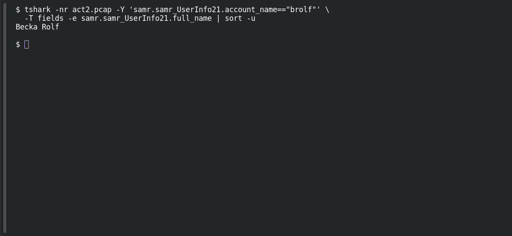

# ACT 2 — The Compromise: Who Is brolf?

**Platform:** PCGCTF · **Challenge ID:** 272 · **Category:** Network Forensics · **Points:** 100

**Status:** Answer backed by the Act 2 capture. Exact PCGCTF submission not independently re-confirmed.

## The challenge

Resolve the account `brolf` to its full name.

## Solving it

Use [the shared capture](../../solved/network-forensics/268-act-2-the-compromise-infected-ipv4/files/2026-02-28-traffic-analysis-exercise.pcap) as `act2.pcap` for the commands below.

The SAMR user-info record carries both fields, so this is a direct read:

```sh
tshark -nr act2.pcap -Y 'samr.samr_UserInfo21.account_name=="brolf"' \
  -T fields -e samr.samr_UserInfo21.full_name | sort -u
```

```text
Becka Rolf
```

## Screenshot

Fresh local reproduction using the command described above.



## Flag

```text
pcgCTF{Becka Rolf}
```

## Takeaway

`brolf` = Becka Rolf — the SAMR record pairs the login name with the display name, so no guessing at the expansion.

## Reference

- [Original challenge description](../../unsolved/network-forensics/272-act-2-the-compromise-who-is-brolf/README.md)
