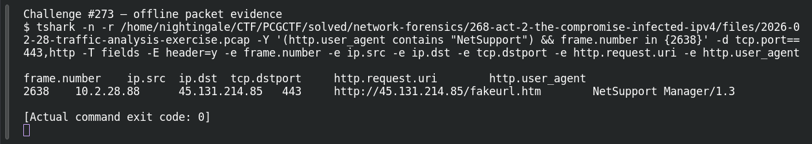

# ACT 2 — The Compromise: RAT Check-In

**Platform:** PCGCTF · **Challenge ID:** 273 · **Category:** Network Forensics · **Points:** 100

**Status:** Answer backed by the Act 2 capture. Exact PCGCTF submission not independently re-confirmed.

## The challenge

Recover the HTTP check-in path the NetSupport RAT keeps hitting.

## Solving it

Filtering the NetSupport requests shows the repeated URI:

```sh
tshark -nr act2.pcap -Y 'http.user_agent contains "NetSupport"' \
  -T fields -e http.request.uri
```

```text
http://45.131.214.85/fakeurl.htm
```

The check-in path is `/fakeurl.htm` — a classic NetSupport default. (Note it's running over port 443 but as cleartext HTTP, not TLS.)

## Screenshot



## Flag

```text
pcgCTF{/fakeurl.htm}
```

## Takeaway

`/fakeurl.htm` is a well-known NetSupport C2 path. Also worth clocking: HTTP on 443 is a deliberate "look like HTTPS" trick.

## Reference

- [Original challenge description](../../solved/network-forensics/273-act-2-the-compromise-rat-check-in/README.md)
