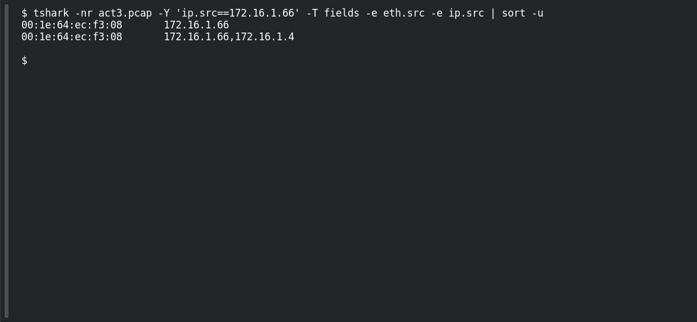

# ACT 3 — Malware Investigation: Endpoint MAC

**Platform:** PCGCTF · **Challenge ID:** 275 · **Category:** Network Forensics · **Points:** 100

**Status:** Answer backed by the Act 3 capture. Exact PCGCTF submission not independently re-confirmed.

## The challenge

Find the MAC of the STRRAT victim (172.16.1.66).

## Solving it

Use [the shared capture](../../unsolved/network-forensics/274-act-3-malware-investigation-compromised-endpoint/files/2024-07-30-traffic-analysis-exercise.pcap) as `act3.pcap` for the commands below.

Same beacon frame carries the source MAC:

```sh
tshark -nr act3.pcap -Y 'ip.src==172.16.1.66' -T fields -e eth.src -e ip.src | sort -u
```

```text
00:1e:64:ec:f3:08	172.16.1.66
00:1e:64:ec:f3:08	172.16.1.66,172.16.1.4
```

## Screenshot

Fresh local reproduction using the command described above.



## Flag

```text
pcgCTF{00:1e:64:ec:f3:08}
```

## Takeaway

Read the MAC from the victim's own outbound frame so the IP↔MAC pairing is unambiguous.

## Reference

- [Original challenge description](../../unsolved/network-forensics/275-act-3-malware-investigation-endpoint-mac/README.md)
