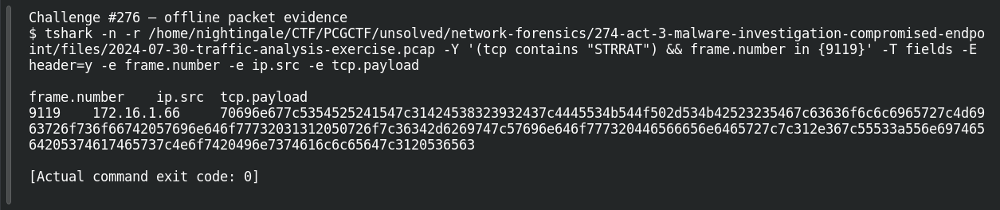

# ACT 3 - MALWARE INVESTIGATION: Endpoint Name

| Item | Record |
|---|---|
| Platform | PCGCTF |
| Challenge ID | 276 |
| Category | Network Forensics |
| Points | 125 |
| Difficulty | Not separately recorded in the available inventory |
| Verification | Needs Flag Verification — the answer has offline evidence, but our PCGCTF snapshot does not record acceptance. A teammate’s reported acceptance, where noted, is separate evidence. |

## Challenge and objective

Recover the Windows hostname of the STRRAT-infected workstation.

The original description and prerequisite chain are preserved in [the challenge README](../../unsolved/network-forensics/276-act-3-malware-investigation-endpoint-name/README.md). The supplied evidence is `2024-07-30-traffic-analysis-exercise.pcap`; related storyline questions reuse the same capture rather than providing another download.

## Initial analysis

The beacon contains host data, but a malware report is best treated as one evidence source rather than unquestioned ground truth.

I kept the original capture intact and used offline packet analysis. The file’s SHA-256 is `c48854c24223cf7b4e9880ea72a21a877e4138e4ce36df7b7656e5c6c4043f68`. This identifies the exact evidence behind the frame references; no reconstructed program was executed and no request was sent to an address found inside the capture.

## Step-by-step solution

### 1. Narrow the incident to a reproducible evidence set

The discovery filter for this question is:

```wireshark
tcp contains "STRRAT"
```

In Wireshark, the filter removes unrelated frames from the display without deleting them from the file. For a command-line reproduction, the following extraction additionally selects the cited frames where appropriate:

```sh
tshark -n \
  -r /home/nightingale/CTF/PCGCTF/unsolved/network-forensics/274-act-3-malware-investigation-compromised-endpoint/files/2024-07-30-traffic-analysis-exercise.pcap \
  -Y '(tcp contains "STRRAT") && frame.number in {9119}' \
  -T fields -E header=y -e frame.number -e ip.src -e tcp.payload
```

`-n` disables address/name resolution so that recorded numeric addresses stay visible. `-r` reads the existing capture, and `-Y` applies a display filter after decoding. `-T fields` outputs selected fields; each `-e` adds one named column, and `-E header=y` records the column names. The `frame.number in {...}` clause makes the final evidence small and auditable; the wider discovery filter remains documented above.

**Actual reproduced output** (tab-separated; full lines are preserved in the linked TSV):

```text
frame.number	ip.src	tcp.payload
9119	172.16.1.66	70696e677c5354525241547c31424538323932437c4445534b544f502d534b42523235467c63636f6c6c6965727c4d6963726f736f66742057696e646f77732031312050726f7c36342d6269747c57696e646f777320446566656e6465727c7c312e367c55533a556e69746564205374617465737c4e6f7420496e7374616c6c65647c3120536563
```

### 2. Interpret the result

Decoded frame 9119 includes DESKTOP-SKBR25F as the fourth pipe-separated field. The previously preserved Kerberos machine-account observation in frame 58 corroborates desktop-skbr25f$. The dollar sign is an account suffix and not part of the hostname.

### Decode the beacon bytes

The `tcp.payload` field above is hexadecimal. This small conversion recovers the application text:

```sh
python - <<'PY'
print(bytes.fromhex('70696e677c5354525241547c31424538323932437c4445534b544f502d534b42523235467c63636f6c6c6965727c4d6963726f736f66742057696e646f77732031312050726f7c36342d6269747c57696e646f777320446566656e6465727c7c312e367c55533a556e69746564205374617465737c4e6f7420496e7374616c6c65647c3120536563').decode('ascii'))
PY
```

The verified payload bytes decode to:

```text
ping|STRRAT|1BE8292C|DESKTOP-SKBR25F|ccollier|Microsoft Windows 11 Pro|64-bit|Windows Defender||1.6|US:United States|Not Installed|1 Sec
```

The separator is `|`. Reading the fields in order gives a message type (`ping`), family (`STRRAT`), identifier, hostname, username, operating system and other profile data. This supports the victim profile without executing the malware.

## Captured screenshots and evidence

Captured on 2026-10-29 from actual terminal sessions or browser views. Captions distinguish new results, preserved records, source images and blockers. No platform acceptance is inferred from these images.

### Challenge #276 — offline packet evidence



Fresh execution of the draft’s field-specific TShark command.

Command/action actually executed:

```sh
tshark -n -r /home/nightingale/CTF/PCGCTF/unsolved/network-forensics/274-act-3-malware-investigation-compromised-endpoint/files/2024-07-30-traffic-analysis-exercise.pcap -Y '(tcp contains "STRRAT") && frame.number in {9119}' -T fields -E header=y -e frame.number -e ip.src -e tcp.payload
```

[Actual command transcript](../screenshots/capture-work/276-network.terminal.log) · [Execution record](../screenshots/capture-work/276-network.result.json). Notice the result fields discussed in the corresponding solution step; the transcript retains lines that extend beyond the screenshot viewport.

## Flag discovery and verification

Saved submission candidate:

```text
pcgCTF{DESKTOP-SKBR25F}
```

Needs Flag Verification — the answer has offline evidence, but our PCGCTF snapshot does not record acceptance. A teammate’s reported acceptance, where noted, is separate evidence. The exact wrapper comes from the challenge’s `pcgCTF{...}` requirement; literal spaces, capitalization and separators are retained as recorded. The focused final check is to submit this exact saved spelling when the platform is available and preserve the resulting acceptance or rejection with the challenge ID.

## Conclusion and lesson

Corroborate an attacker-collected host profile with ordinary network identity traffic when possible. The artifact-backed answer and the platform acceptance state remain separate in this draft.

## Reproduction evidence and references

- [Original challenge description](../../unsolved/network-forensics/276-act-3-malware-investigation-endpoint-name/README.md)
- [Actual TShark field output](../evidence/network/276-fields.tsv)
- [Commands, hashes and reproduction results](../evidence/network/reproduction.json)
- [TShark version](../evidence/network/tshark-version.txt)
- [TShark official manual](https://www.wireshark.org/docs/man-pages/tshark.html)

- [Earlier local solution and provenance](../../unsolved/network-forensics/276-act-3-malware-investigation-endpoint-name/solution.md)
