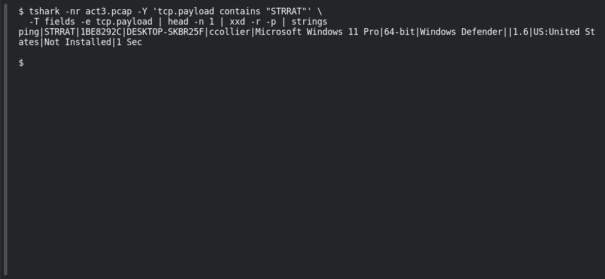

# ACT 3 — Malware Investigation: Endpoint Name

**Platform:** PCGCTF · **Challenge ID:** 276 · **Category:** Network Forensics · **Points:** 100

**Status:** Answer backed by the Act 3 capture. Exact PCGCTF submission not independently re-confirmed.

## The challenge

Recover the STRRAT victim's Windows hostname.

## Solving it

Use [the shared capture](../../unsolved/network-forensics/274-act-3-malware-investigation-compromised-endpoint/files/2024-07-30-traffic-analysis-exercise.pcap) as `act3.pcap` for the commands below.

The hostname is actually inside the STRRAT beacon itself. Pulling the payload and decoding the hex:

```sh
tshark -nr act3.pcap -Y 'tcp.payload contains "STRRAT"' \
  -T fields -e tcp.payload | head -n 1 | xxd -r -p | strings
```

```text
ping|STRRAT|1BE8292C|DESKTOP-SKBR25F|ccollier|Microsoft Windows 11 Pro|64-bit|Windows Defender||1.6|US:United States|Not Installed|1 Sec
```

The decoded beacon includes hostname `DESKTOP-SKBR25F`, user `ccollier`, OS, even the AV.

## Screenshot

Fresh local reproduction using the command described above.



## Flag

```text
pcgCTF{DESKTOP-SKBR25F}
```

## Takeaway

STRRAT's check-in is a self-contained host profile — decode it once and it answers several of these questions at once.

## Reference

- [Original challenge description](../../unsolved/network-forensics/276-act-3-malware-investigation-endpoint-name/README.md)
