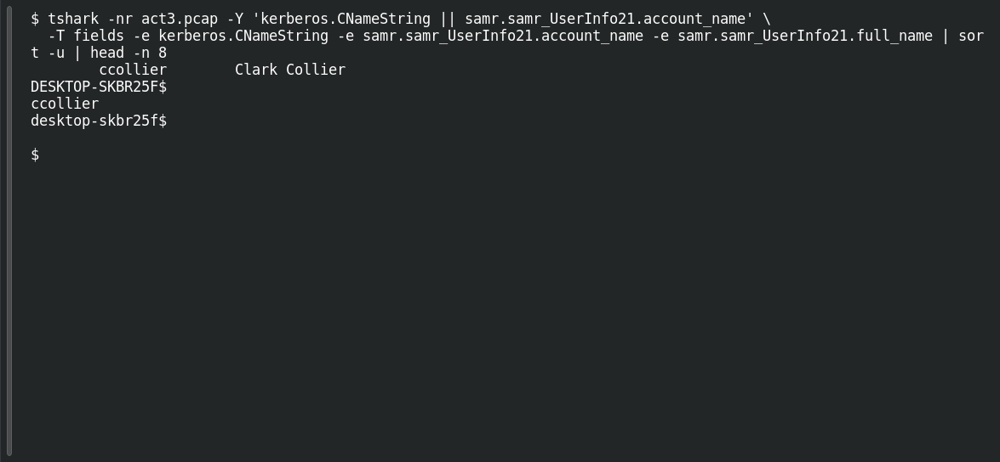

# ACT 3 — Malware Investigation: Compromised Account

**Platform:** PCGCTF · **Challenge ID:** 277 · **Category:** Network Forensics · **Points:** 100

**Status:** Answer backed by the Act 3 capture. Exact PCGCTF submission not independently re-confirmed.

## The challenge

Identify the compromised domain username.

## Solving it

Use [the shared capture](../../unsolved/network-forensics/274-act-3-malware-investigation-compromised-endpoint/files/2024-07-30-traffic-analysis-exercise.pcap) as `act3.pcap` for the commands below.

Two independent sources agree — the Kerberos CNameString from the victim and a SAMR record:

```sh
tshark -nr act3.pcap -Y 'kerberos.CNameString || samr.samr_UserInfo21.account_name' \
  -T fields -e kerberos.CNameString -e samr.samr_UserInfo21.account_name -e samr.samr_UserInfo21.full_name | sort -u | head -n 8
```

```text
ccollier	Clark Collier
DESKTOP-SKBR25F$
ccollier
desktop-skbr25f$
```

The account is `ccollier` (full name Clark Collier — that's #278). It also appears in the decoded STRRAT beacon, a third confirmation.

## Screenshot

Fresh local reproduction using the command described above.



## Flag

```text
pcgCTF{ccollier}
```

## Takeaway

When Kerberos, SAMR, and the malware beacon all name the same user, attribution is solid.

## Reference

- [Original challenge description](../../unsolved/network-forensics/277-act-3-malware-investigation-compromised-account/README.md)
