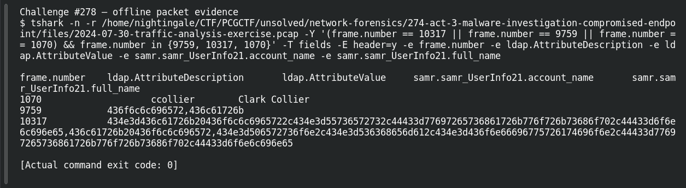

# ACT 3 - MALWARE INVESTIGATION: User Identity

| Item | Record |
|---|---|
| Platform | PCGCTF |
| Challenge ID | 278 |
| Category | Network Forensics |
| Points | 150 |
| Difficulty | Not separately recorded in the available inventory |
| Verification | Needs Flag Verification — the answer has offline evidence, but our PCGCTF snapshot does not record acceptance. A teammate’s reported acceptance, where noted, is separate evidence. |

## Challenge and objective

Recover the full name behind account ccollier from directory-service evidence.

The original description and prerequisite chain are preserved in [the challenge README](../../unsolved/network-forensics/278-act-3-malware-investigation-user-identity/README.md). The supplied evidence is `2024-07-30-traffic-analysis-exercise.pcap`; related storyline questions reuse the same capture rather than providing another download.

## Initial analysis

A signed or wrapped directory session should not lead to the assumption that every attribute is unrecoverable. I examined the saved LDAP responses and the linked SAMR response.

I kept the original capture intact and used offline packet analysis. The file’s SHA-256 is `c48854c24223cf7b4e9880ea72a21a877e4138e4ce36df7b7656e5c6c4043f68`. This identifies the exact evidence behind the frame references; no reconstructed program was executed and no request was sent to an address found inside the capture.

## Step-by-step solution

### 1. Narrow the incident to a reproducible evidence set

The discovery filter for this question is:

```wireshark
frame.number == 10317 || frame.number == 9759 || frame.number == 1070
```

In Wireshark, the filter removes unrelated frames from the display without deleting them from the file. For a command-line reproduction, the following extraction additionally selects the cited frames where appropriate:

```sh
tshark -n \
  -r /home/nightingale/CTF/PCGCTF/unsolved/network-forensics/274-act-3-malware-investigation-compromised-endpoint/files/2024-07-30-traffic-analysis-exercise.pcap \
  -Y '(frame.number == 10317 || frame.number == 9759 || frame.number == 1070) && frame.number in {9759, 10317, 1070}' \
  -T fields -E header=y -e frame.number -e ldap.AttributeDescription -e ldap.AttributeValue -e samr.samr_UserInfo21.account_name -e samr.samr_UserInfo21.full_name
```

`-n` disables address/name resolution so that recorded numeric addresses stay visible. `-r` reads the existing capture, and `-Y` applies a display filter after decoding. `-T fields` outputs selected fields; each `-e` adds one named column, and `-E header=y` records the column names. The `frame.number in {...}` clause makes the final evidence small and auditable; the wider discovery filter remains documented above.

**Actual reproduced output** (tab-separated; full lines are preserved in the linked TSV):

```text
frame.number	ldap.AttributeDescription	ldap.AttributeValue	samr.samr_UserInfo21.account_name	samr.samr_UserInfo21.full_name
1070			ccollier	Clark Collier
9759		436f6c6c696572,436c61726b		
10317		434e3d436c61726b20436f6c6c6965722c434e3d55736572732c44433d77697265736861726b776f726b73686f702c44433d6f6e6c696e65,436c61726b20436f6c6c696572,434e3d506572736f6e2c434e3d536368656d612c434e3d436f6e66696775726174696f6e2c44433d77697265736861726b776f726b73686f702c44433d6f6e6c696e65
```

### 2. Interpret the result

LDAP frame 9759 contains sn=Collier and givenName=Clark. Frame 10317 has displayName=Clark Collier with the matching user DN. SAMR frame 1070 pairs ccollier with that full name. The teammate’s earlier claim that the name was unavailable is therefore contradicted by explicit packet evidence.

### Decode the directory attribute bytes and cross-check the account

The fields output preserves LDAP attribute values as hexadecimal octets in this analyzer version. The saved packet-tree dissection labels them as `givenName`, `sn` and `displayName`. The bytes `436c61726b` and `436f6c6c696572` decode to Clark and Collier, while the SAMR columns directly pair `ccollier` with `Clark Collier`.

```sh
python - <<'PY'
for value in ['436c61726b', '436f6c6c696572']:
    print(bytes.fromhex(value).decode('ascii'))
PY
```

Deterministic decoding of the reproduced attribute bytes yields:

```text
Clark
Collier
```

See [frame 9759’s named attributes](../../analysis-network-forensics/act3-frame-9759.txt) and [frame 10317’s displayName](../../analysis-network-forensics/act3-frame-10317.txt). This is why the name remains evidence-backed despite the teammate’s earlier negative search.

## Captured screenshots and evidence

Captured on 2026-10-29 from actual terminal sessions or browser views. Captions distinguish new results, preserved records, source images and blockers. No platform acceptance is inferred from these images.

### Challenge #278 — offline packet evidence



Fresh execution of the draft’s field-specific TShark command.

Command/action actually executed:

```sh
tshark -n -r /home/nightingale/CTF/PCGCTF/unsolved/network-forensics/274-act-3-malware-investigation-compromised-endpoint/files/2024-07-30-traffic-analysis-exercise.pcap -Y '(frame.number == 10317 || frame.number == 9759 || frame.number == 1070) && frame.number in {9759, 10317, 1070}' -T fields -E header=y -e frame.number -e ldap.AttributeDescription -e ldap.AttributeValue -e samr.samr_UserInfo21.account_name -e samr.samr_UserInfo21.full_name
```

[Actual command transcript](../screenshots/capture-work/278-network.terminal.log) · [Execution record](../screenshots/capture-work/278-network.result.json). Notice the result fields discussed in the corresponding solution step; the transcript retains lines that extend beyond the screenshot viewport.

## Flag discovery and verification

Saved submission candidate:

```text
pcgCTF{Clark Collier}
```

Needs Flag Verification — the answer has offline evidence, but our PCGCTF snapshot does not record acceptance. A teammate’s reported acceptance, where noted, is separate evidence. The exact wrapper comes from the challenge’s `pcgCTF{...}` requirement; literal spaces, capitalization and separators are retained as recorded. The focused final check is to submit this exact saved spelling when the platform is available and preserve the resulting acceptance or rejection with the challenge ID.

## Conclusion and lesson

Inspect the actual decoded records before declaring an entire protocol unreadable. Correlating account and directory attributes resolves ambiguity. The artifact-backed answer and the platform acceptance state remain separate in this draft.

## Reproduction evidence and references

- [Original challenge description](../../unsolved/network-forensics/278-act-3-malware-investigation-user-identity/README.md)
- [Actual TShark field output](../evidence/network/278-fields.tsv)
- [Commands, hashes and reproduction results](../evidence/network/reproduction.json)
- [TShark version](../evidence/network/tshark-version.txt)
- [TShark official manual](https://www.wireshark.org/docs/man-pages/tshark.html)

- [Earlier local solution and provenance](../../unsolved/network-forensics/278-act-3-malware-investigation-user-identity/solution.md)
