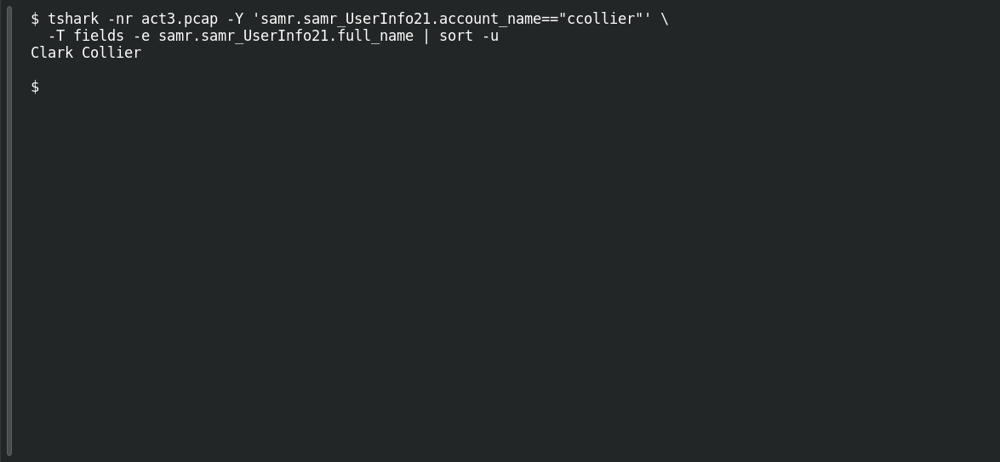

# ACT 3 — Malware Investigation: User Identity

**Platform:** PCGCTF · **Challenge ID:** 278 · **Category:** Network Forensics · **Points:** 100

**Status:** Answer backed by the Act 3 capture. Exact PCGCTF submission not independently re-confirmed.

## The challenge

Recover the full name behind `ccollier` from directory-service traffic.

## Solving it

Use [the shared capture](../../unsolved/network-forensics/274-act-3-malware-investigation-compromised-endpoint/files/2024-07-30-traffic-analysis-exercise.pcap) as `act3.pcap` for the commands below.

A SAMR user-info record states it directly, and the LDAP responses corroborate it (the attribute values are hex — `436c61726b`=`Clark`, `436f6c6c696572`=`Collier`):

```sh
tshark -nr act3.pcap -Y 'samr.samr_UserInfo21.account_name=="ccollier"' \
  -T fields -e samr.samr_UserInfo21.full_name | sort -u
```

```text
Clark Collier
```

The LDAP CN (`CN=Clark Collier,CN=Users,DC=wiresharkworkshop,DC=online`) matches.

## Screenshot

Fresh local reproduction using the command described above.



## Flag

```text
pcgCTF{Clark Collier}
```

## Takeaway

LDAP and SAMR both carry the display name. The LDAP values are hex-encoded — decode before comparing.

## Reference

- [Original challenge description](../../unsolved/network-forensics/278-act-3-malware-investigation-user-identity/README.md)
