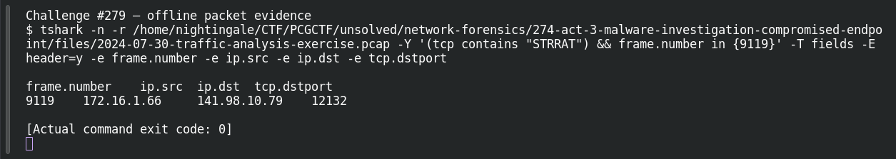

# ACT 3 — Malware Investigation: C2 Destination

**Platform:** PCGCTF · **Challenge ID:** 279 · **Category:** Network Forensics · **Points:** 100

**Status:** Answer backed by the Act 3 capture. Exact PCGCTF submission not independently re-confirmed.

## The challenge

Identify STRRAT's external C2 address.

## Solving it

The destination of the STRRAT beacon is the C2:

```sh
tshark -nr act3.pcap -Y 'tcp.payload contains "STRRAT"' -T fields -e ip.dst -e tcp.dstport
```

```text
141.98.10.79  12132
```

C2 is 141.98.10.79 on the non-standard port 12132.

## Screenshot



## Flag

```text
pcgCTF{141.98.10.79}
```

## Takeaway

The beacon's destination *is* the C2 — and STRRAT's odd high port (12132) is itself a signal.

## Reference

- [Original challenge description](../../solved/network-forensics/279-act-3-malware-investigation-c2-destination/README.md)
