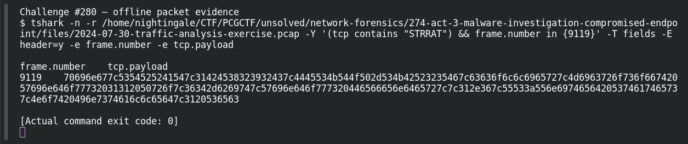

# ACT 3 — Malware Investigation: Malware Family

**Platform:** PCGCTF · **Challenge ID:** 280 · **Category:** Network Forensics · **Points:** 100

**Status:** Answer backed by the Act 3 capture. Exact PCGCTF submission not independently re-confirmed.

## The challenge

Name the RAT family from the application-layer C2 payload.

## Solving it

No OSINT needed — the family name is the second field of the beacon. Decoding the payload:

```sh
tshark -nr act3.pcap -Y 'tcp.payload' -T fields -e tcp.payload | xxd -r -p | head
```

```text
ping|STRRAT|1BE8292C|DESKTOP-SKBR25F|ccollier|...
```

`ping|STRRAT|...` — the family is STRRAT.

## Screenshot



## Flag

```text
pcgCTF{STRRAT}
```

## Takeaway

STRRAT's Java-based beacon labels itself in cleartext. The protocol structure (pipe-delimited host facts) is a strong family fingerprint on its own.

## Reference

- [Original challenge description](../../solved/network-forensics/280-act-3-malware-investigation-malware-family/README.md)
