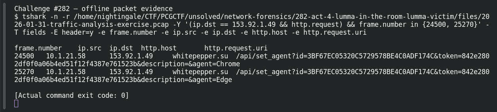

# ACT 4 — Lumma in the Room: Lumma Victim

**Platform:** PCGCTF · **Challenge ID:** 282 · **Category:** Network Forensics · **Points:** 100

**Status:** Answer backed by the Act 4 capture. Exact PCGCTF submission not independently re-confirmed.

## The challenge

Identify the client sending Lumma victim-fingerprinting requests.

## Solving it

Lumma registers victims via `/api/set_agent` calls. Filtering those shows one source host:

```sh
tshark -nr act4.pcap -Y 'http.request.uri contains "/api/set_agent"' \
  -T fields -e ip.src -e http.host -e http.request.uri
```

```text
10.1.21.58  whitepepper.su  /api/set_agent?id=3BF67EC0...&agent=Chrome
10.1.21.58  whitepepper.su  /api/set_agent?id=3BF67EC0...&agent=Edge
```

The victim is 10.1.21.58, posting fingerprints to `whitepepper.su`.

## Screenshot



## Flag

```text
pcgCTF{10.1.21.58}
```

## Takeaway

Lumma's `set_agent` registration (with the same victim `id` token repeated across browsers) is a clean fingerprint for the infected host.

## Reference

- [Original challenge description](../../solved/network-forensics/282-act-4-lumma-in-the-room-lumma-victim/README.md)
