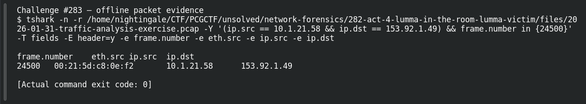

# ACT 4 — Lumma in the Room: Victim MAC

**Platform:** PCGCTF · **Challenge ID:** 283 · **Category:** Network Forensics · **Points:** 100

**Status:** Answer backed by the Act 4 capture. Exact PCGCTF submission not independently re-confirmed.

## The challenge

Read the Lumma victim's MAC (10.1.21.58).

## Solving it

```sh
tshark -nr act4.pcap -Y 'ip.src==10.1.21.58' -T fields -e eth.src -e ip.src
```

```text
00:21:5d:c8:0e:f2  10.1.21.58
```

## Screenshot



## Flag

```text
pcgCTF{00:21:5d:c8:0e:f2}
```

## Takeaway

Straight IP→MAC read from the victim's own frames.

## Reference

- [Original challenge description](../../solved/network-forensics/283-act-4-lumma-in-the-room-victim-mac/README.md)
