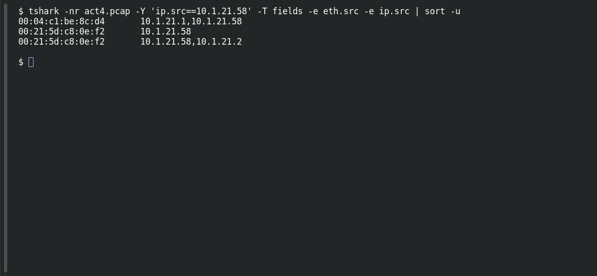

# ACT 4 — Lumma in the Room: Victim MAC

**Platform:** PCGCTF · **Challenge ID:** 283 · **Category:** Network Forensics · **Points:** 100

**Status:** Answer backed by the Act 4 capture. Exact PCGCTF submission not independently re-confirmed.

**Evidence:** Packet 24500 · TCP stream 99 · [2026-01-31-traffic-analysis-exercise.pcap](../../unsolved/network-forensics/282-act-4-lumma-in-the-room-lumma-victim/files/2026-01-31-traffic-analysis-exercise.pcap).

## The challenge

Read the Lumma victim's MAC (10.1.21.58).

## Solving it

Use [the shared capture](../../unsolved/network-forensics/282-act-4-lumma-in-the-room-lumma-victim/files/2026-01-31-traffic-analysis-exercise.pcap) as `act4.pcap` for the commands below.

```sh
tshark -nr act4.pcap -Y 'ip.src==10.1.21.58' -T fields -e eth.src -e ip.src | sort -u
```

```text
00:04:c1:be:8c:d4	10.1.21.1,10.1.21.58
00:21:5d:c8:0e:f2	10.1.21.58
00:21:5d:c8:0e:f2	10.1.21.58,10.1.21.2
```

## Screenshot

Fresh local reproduction using the command described above.



## Flag

```text
pcgCTF{00:21:5d:c8:0e:f2}
```

## Takeaway

Straight IP→MAC read from the victim's own frames.

## Reference

- [Original challenge description](../../unsolved/network-forensics/283-act-4-lumma-in-the-room-victim-mac/README.md)
