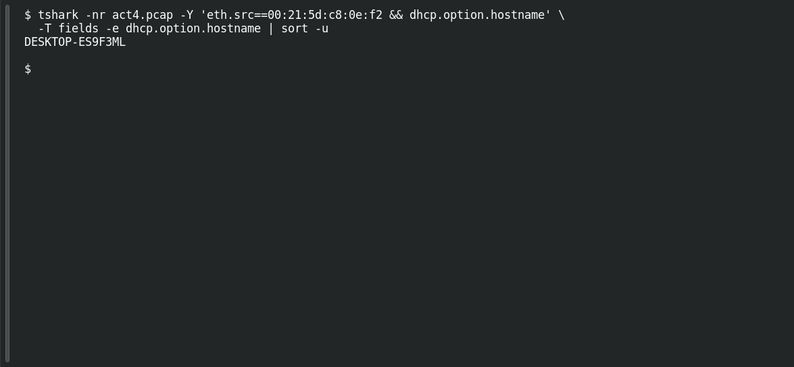

# ACT 4 — Lumma in the Room: Victim Hostname

**Platform:** PCGCTF · **Challenge ID:** 284 · **Category:** Network Forensics · **Points:** 100

**Status:** Answer backed by the Act 4 capture. Exact PCGCTF submission not independently re-confirmed.

**Evidence:** Packets 1, 3, 5 · UDP streams 0, 2 · [2026-01-31-traffic-analysis-exercise.pcap](../../unsolved/network-forensics/282-act-4-lumma-in-the-room-lumma-victim/files/2026-01-31-traffic-analysis-exercise.pcap).

## The challenge

Recover the Lumma victim's hostname.

## Solving it

Use [the shared capture](../../unsolved/network-forensics/282-act-4-lumma-in-the-room-lumma-victim/files/2026-01-31-traffic-analysis-exercise.pcap) as `act4.pcap` for the commands below.

The host's DHCP request (sent from 0.0.0.0 before it had an address) names it:

```sh
tshark -nr act4.pcap -Y 'eth.src==00:21:5d:c8:0e:f2 && dhcp.option.hostname' \
  -T fields -e dhcp.option.hostname | sort -u
```

```text
DESKTOP-ES9F3ML
```

## Screenshot

Fresh local reproduction using the command described above.



## Flag

```text
pcgCTF{DESKTOP-ES9F3ML}
```

## Takeaway

DHCP option 12 names the host even before it has an IP — match on the MAC to be sure it's the right one.

## Reference

- [Original challenge description](../../unsolved/network-forensics/284-act-4-lumma-in-the-room-victim-hostname/README.md)
