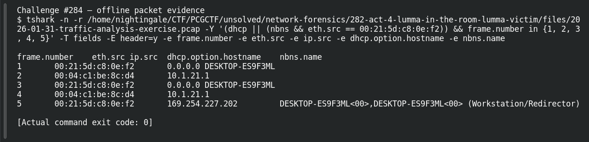

# ACT 4 - LUMMA IN THE ROOM: Victim Hostname

| Item | Record |
|---|---|
| Platform | PCGCTF |
| Challenge ID | 284 |
| Category | Network Forensics |
| Points | 150 |
| Difficulty | Not separately recorded in the available inventory |
| Verification | Needs Flag Verification — the answer has offline evidence, but our PCGCTF snapshot does not record acceptance. A teammate’s reported acceptance, where noted, is separate evidence. |

## Challenge and objective

Recover the hostname assigned to the Lumma victim.

The original description and prerequisite chain are preserved in [the challenge README](../../unsolved/network-forensics/284-act-4-lumma-in-the-room-victim-hostname/README.md). The supplied evidence is `2026-01-31-traffic-analysis-exercise.pcap`; related storyline questions reuse the same capture rather than providing another download.

## Initial analysis

DHCP and NBNS provide host names independently of the malicious HTTP. I matched their MAC address to the C2 request.

I kept the original capture intact and used offline packet analysis. The file’s SHA-256 is `f755444d0b6eac847e07b73dea0774084b232d8577f536547a12f39b959d7833`. This identifies the exact evidence behind the frame references; no reconstructed program was executed and no request was sent to an address found inside the capture.

## Step-by-step solution

### 1. Narrow the incident to a reproducible evidence set

The discovery filter for this question is:

```wireshark
dhcp || (nbns && eth.src == 00:21:5d:c8:0e:f2)
```

In Wireshark, the filter removes unrelated frames from the display without deleting them from the file. For a command-line reproduction, the following extraction additionally selects the cited frames where appropriate:

```sh
tshark -n \
  -r /home/nightingale/CTF/PCGCTF/unsolved/network-forensics/282-act-4-lumma-in-the-room-lumma-victim/files/2026-01-31-traffic-analysis-exercise.pcap \
  -Y '(dhcp || (nbns && eth.src == 00:21:5d:c8:0e:f2)) && frame.number in {1, 2, 3, 4, 5}' \
  -T fields -E header=y -e frame.number -e eth.src -e ip.src -e dhcp.option.hostname -e nbns.name
```

`-n` disables address/name resolution so that recorded numeric addresses stay visible. `-r` reads the existing capture, and `-Y` applies a display filter after decoding. `-T fields` outputs selected fields; each `-e` adds one named column, and `-E header=y` records the column names. The `frame.number in {...}` clause makes the final evidence small and auditable; the wider discovery filter remains documented above.

**Actual reproduced output** (tab-separated; full lines are preserved in the linked TSV):

```text
frame.number	eth.src	ip.src	dhcp.option.hostname	nbns.name
1	00:21:5d:c8:0e:f2	0.0.0.0	DESKTOP-ES9F3ML	
2	00:04:c1:be:8c:d4	10.1.21.1		
3	00:21:5d:c8:0e:f2	0.0.0.0	DESKTOP-ES9F3ML	
4	00:04:c1:be:8c:d4	10.1.21.1		
5	00:21:5d:c8:0e:f2	169.254.227.202		DESKTOP-ES9F3ML<00>,DESKTOP-ES9F3ML<00> (Workstation/Redirector)
```

### 2. Interpret the result

DHCP frame 1 and later DHCP exchange records identify DESKTOP-ES9F3ML from 00:21:5d:c8:0e:f2. The address-configuration sequence assigns 10.1.21.58, and NBNS in the saved identity table corroborates the name.

## Captured screenshots and evidence

Captured on 2026-10-29 from actual terminal sessions or browser views. Captions distinguish new results, preserved records, source images and blockers. No platform acceptance is inferred from these images.

### Challenge #284 — offline packet evidence



Fresh execution of the draft’s field-specific TShark command.

Command/action actually executed:

```sh
tshark -n -r /home/nightingale/CTF/PCGCTF/unsolved/network-forensics/282-act-4-lumma-in-the-room-lumma-victim/files/2026-01-31-traffic-analysis-exercise.pcap -Y '(dhcp || (nbns && eth.src == 00:21:5d:c8:0e:f2)) && frame.number in {1, 2, 3, 4, 5}' -T fields -E header=y -e frame.number -e eth.src -e ip.src -e dhcp.option.hostname -e nbns.name
```

[Actual command transcript](../screenshots/capture-work/284-network.terminal.log) · [Execution record](../screenshots/capture-work/284-network.result.json). Notice the result fields discussed in the corresponding solution step; the transcript retains lines that extend beyond the screenshot viewport.

## Flag discovery and verification

Saved submission candidate:

```text
pcgCTF{DESKTOP-ES9F3ML}
```

Needs Flag Verification — the answer has offline evidence, but our PCGCTF snapshot does not record acceptance. A teammate’s reported acceptance, where noted, is separate evidence. The exact wrapper comes from the challenge’s `pcgCTF{...}` requirement; literal spaces, capitalization and separators are retained as recorded. The focused final check is to submit this exact saved spelling when the platform is available and preserve the resulting acceptance or rejection with the challenge ID.

## Conclusion and lesson

A host’s identity can be established across its configuration and later malicious traffic by keeping the same hardware-address pivot. The artifact-backed answer and the platform acceptance state remain separate in this draft.

## Reproduction evidence and references

- [Original challenge description](../../unsolved/network-forensics/284-act-4-lumma-in-the-room-victim-hostname/README.md)
- [Actual TShark field output](../evidence/network/284-fields.tsv)
- [Commands, hashes and reproduction results](../evidence/network/reproduction.json)
- [TShark version](../evidence/network/tshark-version.txt)
- [TShark official manual](https://www.wireshark.org/docs/man-pages/tshark.html)

- [Earlier local solution and provenance](../../unsolved/network-forensics/284-act-4-lumma-in-the-room-victim-hostname/solution.md)
