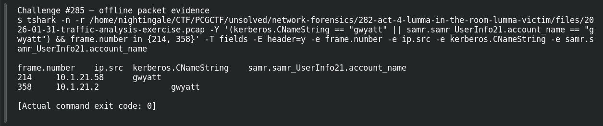

# ACT 4 — Lumma in the Room: Compromised User

**Platform:** PCGCTF · **Challenge ID:** 285 · **Category:** Network Forensics · **Points:** 100

**Status:** Answer backed by the Act 4 capture. Exact PCGCTF submission not independently re-confirmed.

## The challenge

Find the user account tied to the Lumma client.

## Solving it

Kerberos from the victim and a SAMR record agree:

```sh
tshark -nr act4.pcap -Y 'kerberos.CNameString || samr.samr_UserInfo21.account_name' \
  -T fields -e kerberos.CNameString -e samr.samr_UserInfo21.account_name
```

```text
gwyatt  —
—       gwyatt
```

The account is `gwyatt`.

## Screenshot



## Flag

```text
pcgCTF{gwyatt}
```

## Takeaway

Kerberos CNameString from the victim's IP + a matching SAMR record is the standard one-two for user attribution.

## Reference

- [Original challenge description](../../solved/network-forensics/285-act-4-lumma-in-the-room-compromised-user/README.md)
