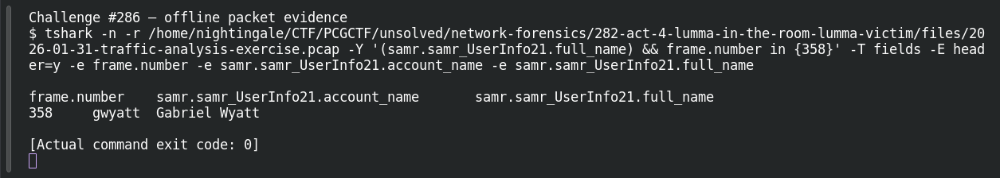

# ACT 4 — Lumma in the Room: Full User Name

**Platform:** PCGCTF · **Challenge ID:** 286 · **Category:** Network Forensics · **Points:** 100

**Status:** Answer backed by the Act 4 capture. Exact PCGCTF submission not independently re-confirmed.

## The challenge

Resolve `gwyatt` to a full name.

## Solving it

```sh
tshark -nr act4.pcap -Y 'samr.samr_UserInfo21.account_name=="gwyatt"' \
  -T fields -e samr.samr_UserInfo21.full_name
```

```text
Gabriel Wyatt
```

## Screenshot



## Flag

```text
pcgCTF{Gabriel Wyatt}
```

## Takeaway

`gwyatt` = Gabriel Wyatt, straight from the SAMR display name.

## Reference

- [Original challenge description](../../solved/network-forensics/286-act-4-lumma-in-the-room-full-user-name/README.md)
