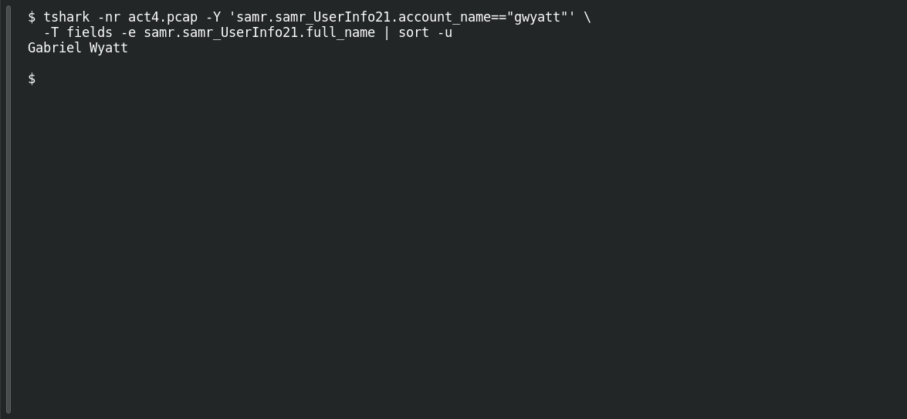

# ACT 4 — Lumma in the Room: Full User Name

**Platform:** PCGCTF · **Challenge ID:** 286 · **Category:** Network Forensics · **Points:** 100

**Status:** Answer backed by the Act 4 capture. Exact PCGCTF submission not independently re-confirmed.

## The challenge

Resolve `gwyatt` to a full name.

## Solving it

Use [the shared capture](../../unsolved/network-forensics/282-act-4-lumma-in-the-room-lumma-victim/files/2026-01-31-traffic-analysis-exercise.pcap) as `act4.pcap` for the commands below.

```sh
tshark -nr act4.pcap -Y 'samr.samr_UserInfo21.account_name=="gwyatt"' \
  -T fields -e samr.samr_UserInfo21.full_name | sort -u
```

```text
Gabriel Wyatt
```

## Screenshot

Fresh local reproduction using the command described above.



## Flag

```text
pcgCTF{Gabriel Wyatt}
```

## Takeaway

`gwyatt` = Gabriel Wyatt, straight from the SAMR display name.

## Reference

- [Original challenge description](../../unsolved/network-forensics/286-act-4-lumma-in-the-room-full-user-name/README.md)
