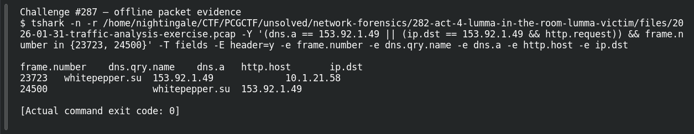

# ACT 4 — Lumma in the Room: Malicious Domain

**Platform:** PCGCTF · **Challenge ID:** 287 · **Category:** Network Forensics · **Points:** 100

**Status:** Answer backed by the Act 4 capture. Exact PCGCTF submission not independently re-confirmed.

## The challenge

Identify the C2 domain behind 153.92.1.49.

## Solving it

The DNS answer ties the name to the IP, and the HTTP Host confirms it:

```sh
tshark -nr act4.pcap -Y 'dns.a==153.92.1.49 || (http.host && ip.dst==153.92.1.49)' \
  -T fields -e dns.qry.name -e dns.a -e http.host
```

```text
whitepepper.su  153.92.1.49  —
—               —            whitepepper.su
```

The C2 domain is `whitepepper.su`.

## Screenshot



## Flag

```text
pcgCTF{whitepepper.su}
```

## Takeaway

Tie the domain to the IP via the DNS answer rather than assuming — then the HTTP Host is corroboration, not the sole source.

## Reference

- [Original challenge description](../../solved/network-forensics/287-act-4-lumma-in-the-room-malicious-domain/README.md)
