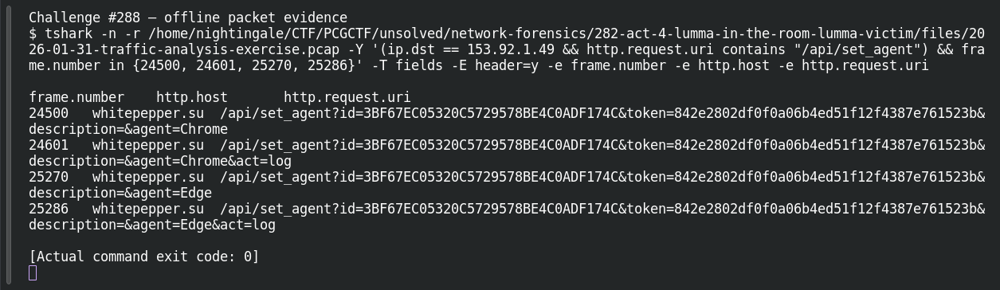

# ACT 4 — Lumma in the Room: Fingerprint API

**Platform:** PCGCTF · **Challenge ID:** 288 · **Category:** Network Forensics · **Points:** 100

**Status:** Answer backed by the Act 4 capture. Exact PCGCTF submission not independently re-confirmed.

## The challenge

Recover the API path Lumma uses for victim registration.

## Solving it

```sh
tshark -nr act4.pcap -Y 'http.host=="whitepepper.su"' -T fields -e http.request.uri
```

```text
/api/set_agent?id=3BF67EC0...&agent=Chrome
/api/set_agent?id=3BF67EC0...&agent=Chrome&act=log
/api/set_agent?id=3BF67EC0...&agent=Edge
```

Stripping the query string, the endpoint is `/api/set_agent`.

## Screenshot



## Flag

```text
pcgCTF{/api/set_agent}
```

## Takeaway

`/api/set_agent` is Lumma's registration endpoint. The answer is the path — the `id`/`token` query parameters are the per-victim data, not part of it.

## Reference

- [Original challenge description](../../solved/network-forensics/288-act-4-lumma-in-the-room-fingerprint-api/README.md)
