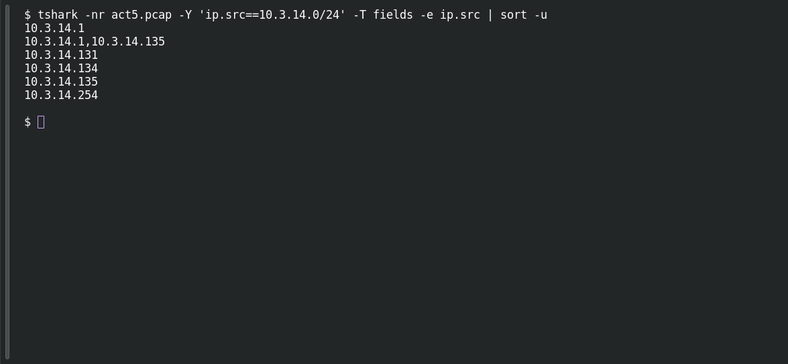

# ACT 5 — Final Incident: Map the Network

**Platform:** PCGCTF · **Challenge ID:** 289 · **Category:** Network Forensics · **Points:** 100

**Status:** Answer backed by the Act 5 capture. Exact PCGCTF submission not independently re-confirmed.

**Evidence:** Packets 6, 1684, 1771 · UDP stream 1 · [2017-02-11-traffic-analysis-exercise.pcap](../../unsolved/network-forensics/289-act-5-final-incident-map-the-network/files/2017-02-11-traffic-analysis-exercise.pcap).

## The challenge

List the three workstation IPv4 addresses, ascending.

## Solving it

Use [the shared capture](../../unsolved/network-forensics/289-act-5-final-incident-map-the-network/files/2017-02-11-traffic-analysis-exercise.pcap) as `act5.pcap` for the commands below.

Start by listing the local source addresses in the capture:

```sh
tshark -nr act5.pcap -Y 'ip.src==10.3.14.0/24' -T fields -e ip.src | sort -u
```

```text
10.3.14.1
10.3.14.1,10.3.14.135
10.3.14.131
10.3.14.134
10.3.14.135
10.3.14.254
```

This lists infrastructure as well as workstations. The comma-separated row contains multiple IP source fields from one packet; it is not another address.

The saved host analysis identifies `.131`, `.134` and `.135` as the three clients. Their traffic is examined in the following challenges: `.131` contacts the Spora portal, `.134` shows the Cerber pattern and identifies itself as `Knutson-PC`, and `.135` uses Apple services and browses Reddit. `.254` appears as the DHCP server in the identity records. The three workstation addresses, sorted numerically, are `10.3.14.131`, `10.3.14.134` and `10.3.14.135`.

The screenshot below shows the broad address query. The host analysis above supplies the workstation roles.

## Screenshot

Fresh local reproduction using the command described above.



## Flag

```text
pcgCTF{10.3.14.131_10.3.14.134_10.3.14.135}
```

## Takeaway

Note the format the challenge wants — these are joined with underscores, in ascending order.

## Reference

- [Original challenge description](../../unsolved/network-forensics/289-act-5-final-incident-map-the-network/README.md)
- [Saved host identity analysis](../../analysis-act4-act5/act5-identity.tsv)
- [Saved network analysis](../../analysis-act4-act5/answers.md)
