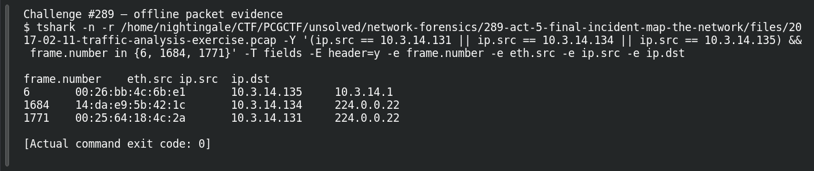

# ACT 5 — Final Incident: Map the Network

**Platform:** PCGCTF · **Challenge ID:** 289 · **Category:** Network Forensics · **Points:** 100

**Status:** Answer backed by the Act 5 capture. Exact PCGCTF submission not independently re-confirmed.

## The challenge

List the three workstation IPv4 addresses, ascending.

## Solving it

I pulled the distinct internal `10.3.14.x` source addresses:

```sh
tshark -nr act5.pcap -Y 'ip.src==10.3.14.0/24' -T fields -e ip.src | sort -u
```

```text
10.3.14.131
10.3.14.134
10.3.14.135
```

Three hosts, in order.

## Screenshot



## Flag

```text
pcgCTF{10.3.14.131_10.3.14.134_10.3.14.135}
```

## Takeaway

Note the format the challenge wants — these are joined with underscores, in ascending order.

## Reference

- [Original challenge description](../../solved/network-forensics/289-act-5-final-incident-map-the-network/README.md)
